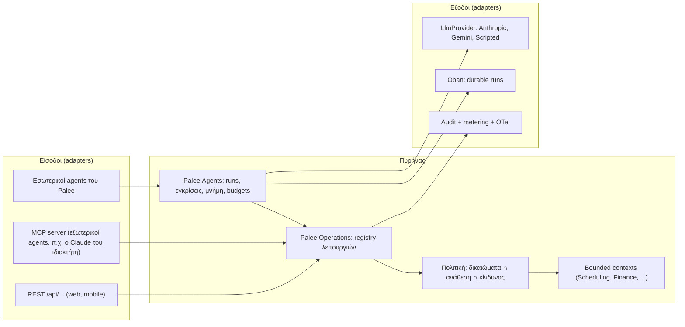
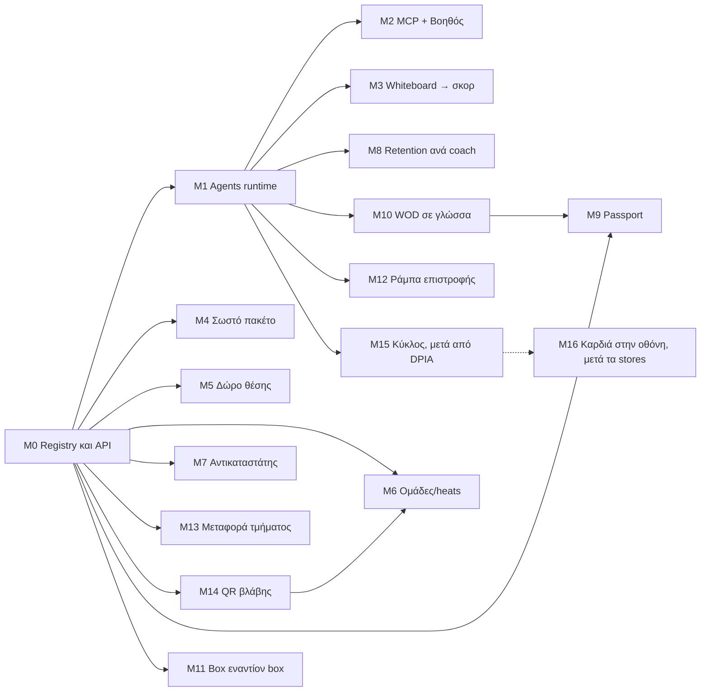

# Palee v4.0.0: πρωτότυπα features και AI agents ως πλήρη μέλη της εφαρμογής

> Ημερομηνία: 29 Οκτωβρίου 2026 · Ζήτησε: ANR · Κατάσταση: **μόνο σχέδιο**. Η υλοποίηση ξεκινά όταν το v3 είναι σε παραγωγή.
> Πηγή των features: [Palee: πρωτότυπα features που δεν έχει κανείς](https://claude.ai/artifact/P3rdsaqY41p7vDiZ2mKPWp) (14 ιδέες).
> Αρχές που ισχύουν πάντα: §4 του `docs/product/2026-10-15-palee-product-vision-and-ia.md`, hexagonal με έλεγχο στο compile (ADR-043), ονόματα από το `docs/product/ontology.md`, κάθε αλλαγή με tests (UI, web, e2e), mockups με εναλλακτικές πριν από κάθε νέα οθόνη.
> Δεσμευμένα για το v4: **ADR-300 έως ADR-339**, migrations από **20270401000000**. Το v3 χρησιμοποιεί ADR-240–263 και migrations έως 20270220*. Πριν πάρετε αριθμό, ελέγξτε όλα τα branches στο origin.

## 1. Τι ζήτησε ο ANR και πώς το διάβασα

ANR (29/10, 17:35 Ελλάδα), σε σύνοψη:

- Να γίνουν **και τα 14 features**, ως έκδοση **v4**.
- Η υλοποίηση να είναι στιβαρή σε όλα τα επίπεδα του hexagonal και να ακολουθεί δοκιμασμένα πρότυπα.
- Τα features με AI (LLMs) να σχεδιαστούν ώστε ο **AI agent να είναι πλήρες μέλος της εφαρμογής**. Δηλαδή να μπορεί να βρει τον δρόμο του μέσα στην εφαρμογή, να τη διαβάσει, να τη χρησιμοποιήσει και να πάρει όσα στοιχεία χρειάζεται για τη δουλειά του.
- Όπου βοηθά, ο κώδικας να υποστηρίζει και **πολλούς agents που συνεργάζονται**.
- Η εφαρμογή να είναι API-first, φτιαγμένη για agents, ασφαλής, modular και έτοιμη για το μέλλον. «Μακάρι να ήταν όλη η εφαρμογή έτσι, τουλάχιστον τα νέα features.»
- Οι αλλαγές σε υπάρχοντα κώδικα και σχήματα να είναι **προσθετικές**.

Οι αποφάσεις που πήρα για το σχέδιο:

1. Το v4 ξεκινά με ένα **θεμέλιο για agents** (milestones V4-M0 έως V4-M2). Τα 14 features χτίζονται πάνω του. Το θεμέλιο είναι γενικό, ώστε **και η υπόλοιπη εφαρμογή** να μπαίνει σταδιακά, μία λειτουργία τη φορά, χωρίς μεγάλη αλλαγή (§3.9).
2. **Ντετερμινιστικός κώδικας πρώτα, LLM μόνο όπου προσθέτει κάτι.** Από τα 14 features, μόνο τα 1, 8 και, προαιρετικά, το 6 χρειάζονται LLM. Τα υπόλοιπα είναι κανόνες, αλγόριθμοι και ροές. Όλα όμως εκτίθενται στους agents ως εργαλεία, ώστε ένας agent να μπορεί να τα χρησιμοποιήσει.
3. Ένας agent **δεν έχει ποτέ περισσότερα δικαιώματα από τον άνθρωπο για λογαριασμό του οποίου δρα**. Πράξεις που δεν αναιρούνται, πράξεις προς τα έξω και πράξεις με χρήματα θέλουν έγκριση από άνθρωπο (§3.5).
4. Ο κανόνας για το UI δεν αλλάζει: καμία νέα καρτέλα, καμία νέα πολυπλοκότητα στο πρώτο επίπεδο. Οι agents φαίνονται μόνο εκεί όπου ήδη δουλεύει ο άνθρωπος.

## 2. Έρευνα: πρότυπα που υιοθετούμε

| Θέμα | Τι ισχύει (Οκτ. 2026) | Τι σημαίνει για το Palee | Πηγή |
|---|---|---|---|
| MCP | Η έκδοση 2026-07-28 έχει stateless πυρήνα, χωρίς `initialize` και `Mcp-Session-Id`. Τα tasks έγιναν επέκταση (`io.modelcontextprotocol/tasks`, polling με `tasks/get`). Υπάρχει αυστηρότερο OAuth (έλεγχος `iss`, RFC 9207). | Ο MCP server του Palee είναι ένα stateless adapter πάνω στο registry λειτουργιών (§3.2). Οι μακριές δουλειές επιστρέφουν task handle. | [changelog](https://modelcontextprotocol.io/specification/2026-07-28/changelog), [ανακοίνωση](https://blog.modelcontextprotocol.io/posts/2026-07-28/) |
| A2A | Η έκδοση 1.0 κυκλοφόρησε το 2026, στο Linux Foundation, με υπογεγραμμένα Agent Cards. Το A2A καλύπτει επικοινωνία agent με agent, ενώ το MCP καλύπτει agent με εργαλεία. | Το v4 δεν το χρειάζεται για τη λειτουργία του. Το μοντέλο agents όμως έχει τα πεδία ενός Agent Card (ταυτότητα, δεξιότητες, auth), ώστε ένας A2A adapter να είναι απλώς ακόμη ένας adapter. | [Linux Foundation](https://linuxfoundation.org/press/a2a-protocol-surpasses-150-organizations-lands-in-major-cloud-platforms-and-sees-enterprise-production-use-in-first-year) |
| Ανάθεση σε agents | Η βάση είναι το OAuth Token Exchange (RFC 8693, claim `act`), με drafts του 2026 για περιορισμό δικαιωμάτων σε κάθε βήμα και ανάκληση. Το `act` μόνο του είναι πληροφοριακό, και υπάρχει γνωστή επίθεση splicing. | Δικό μας token agent με `sub`, `act`, scopes και `run_id`. Ο server επιβάλλει την τομή των δικαιωμάτων σε κάθε κλήση, χωρίς να εμπιστεύεται το token. | [draft-sweeney-wimse-credential-delegation](https://datatracker.ietf.org/doc/draft-sweeney-wimse-credential-delegation/), [delegation receipts](https://www.ietf.org/archive/id/draft-nelson-agent-delegation-receipts-11.html) |
| Prompt injection | Το «Agents Rule of Two» της Meta λέει ότι σε μία συνεδρία συνδυάζουμε το πολύ 2 από 3: (α) μη έμπιστη είσοδο, (β) ιδιωτικά δεδομένα, (γ) αλλαγή κατάστασης ή επικοινωνία προς τα έξω. Αν χρειάζονται και τα 3, μπαίνει άνθρωπος. | Κάθε run δηλώνει ποια από τα 3 αγγίζει, και ο κώδικας το επιβάλλει (§3.5). | [Meta AI](https://ai.meta.com/blog/practical-ai-agent-security/) |
| Κίνδυνοι agents | Το OWASP Top 10 for Agentic Applications 2026 (ASI01–ASI10) καλύπτει goal hijack, κατάχρηση εργαλείων, ταυτότητα και δικαιώματα, rogue agents και άλλα. | Κάθε κίνδυνος έχει έλεγχο και test στο §3.5. | [OWASP](https://genai.owasp.org/resource/owasp-top-10-for-agentic-applications-for-2026) |
| Κανονισμοί ΕΕ | AI Act: οι υποχρεώσεις διαφάνειας του άρθρου 50 ισχύουν από 2/8/2026. GDPR άρθρο 9: τα δεδομένα υγείας (κύκλος, καρδιά, τραυματισμοί) είναι ειδική κατηγορία. | Ό,τι παράγει AI σημαίνεται ως AI. Χρειάζεται DPIA για τα features 13 και 14. Οι πάροχοι LLM καλούνται από την ΕΕ ή με DPA. | Ελέγχεται από νομικό πριν από το M15 |
| Λοιπά πρότυπα HTTP | RFC 9457 (problem details), το draft για το `Idempotency-Key`, ETag/`If-Match` για ταυτόχρονες αλλαγές, OpenAPI 3.1 (JSON Schema 2020-12), OpenTelemetry GenAI semantic conventions. | Γίνονται κανόνας για κάθε νέα λειτουργία (V4-M0). | |

Οι πηγές του MCP και του OWASP είναι οι επίσημες. Τα drafts του IETF δεν είναι ακόμη πρότυπα, γι' αυτό το Palee κρατά δική του επιβολή στον server και δεν εξαρτάται από αυτά.

## 3. Αρχιτεκτονική του θεμελίου

### 3.1 Η εικόνα με μια ματιά



Μία λειτουργία ορίζεται **μία φορά** στο registry. Από εκεί βγαίνουν το REST endpoint, το εργαλείο MCP, το εργαλείο των εσωτερικών agents, το OpenAPI και οι τύποι του web client. Άνθρωπος και agent περνούν από τον ίδιο δρόμο, με τους ίδιους ελέγχους.

### 3.2 `Palee.Operations`: το registry λειτουργιών (ADR-300)

Κάθε use case (command ή query) γίνεται ένα module που υλοποιεί το behaviour `Palee.Operations.Operation`:

| Callback / πεδίο | Περιεχόμενο |
|---|---|
| `spec/0` | `name` (π.χ. `scheduling.move_bookings`), `version`, `kind` (`:query`/`:command`), `summary` και `description` γραμμένα για agent (πότε τη χρησιμοποιείς, πότε όχι), `input`/`output` JSON Schema 2020-12, `examples` |
| `capability` | ό,τι ήδη ορίζει το ADR-099 (π.χ. `:manage_schedule`), μαζί με το scope (`:all`/`:own`) |
| `risk` | `:read` · `:write_reversible` · `:write_irreversible` · `:outward` (μήνυμα, email, push σε άλλους) · `:money` |
| `data_classes` | ποια δεδομένα επιστρέφει: `:personal`, `:health` (GDPR άρθρο 9), `:financial`, `:user_generated` (μη έμπιστο κείμενο) |
| `idempotent?`, `preview/2` | κάθε command υποστηρίζει **προεπισκόπηση** (dry run), που επιστρέφει τι θα αλλάξει χωρίς να γράψει τίποτα |
| `execute/2` | καλεί **μόνο** τη δημόσια API του context ή ένα application service (ADR-043) |
| `next_actions/2` | προαιρετικά, προτάσεις για το επόμενο βήμα («μετά από αυτό, ίσως `notifications.send_to_class`»), ώστε ο agent να βρίσκει τον δρόμο του |

Κανόνες:

- **Χωρίς macros που κρύβουν λογική.** Plain behaviour και structs, όπως ζητά το ADR-043. Το registry συγκεντρώνει τα modules κατά το compile, από μια λίστα στο config, και ένα test ελέγχει ότι δεν λείπει καμία.
- **Ένα σχήμα, πολλές μορφές.** Από το `spec` παράγονται: OpenApiSpex schemas (ήδη υπάρχει OpenAPI, ADR-134), εργαλεία MCP, εργαλεία LLM (Anthropic `tools` και Gemini `functionDeclarations`, μέσω ενός μετατροπέα στον adapter) και τύποι TypeScript. Το σχήμα δεν γράφεται δεύτερη φορά πουθενά.
- **Εκδόσεις:** μια αλλαγή που σπάει κάτι δημιουργεί νέα `version`. Η παλιά μένει μέχρι να τη σταματήσει να καλεί ο τελευταίος client. Το registry ξέρει ποια είναι deprecated και το λέει στον agent.
- **Contract tests** για κάθε λειτουργία: το σχήμα είναι έγκυρο, υπάρχει παράδειγμα, η είσοδος του παραδείγματος περνά, η capability υπάρχει στον πίνακα του ADR-099, ο κίνδυνος έχει δηλωθεί, και ένα command χωρίς `preview` αποτυγχάνει.

### 3.3 Κανόνες API για κάθε νέα λειτουργία (V4-M0)

1. **Σφάλματα RFC 9457** (`application/problem+json`): `type` (σταθερό URI ανά λόγο), `title`, `detail`, `errors[]` ανά πεδίο, και `remedy` όταν υπάρχει (π.χ. «χρειάζεται `:manage_schedule`», «διάλεξε ώρα μετά τις 06:00»). Ο agent διορθώνει μόνος του. Ο άνθρωπος βλέπει το ίδιο κείμενο μέσα στη φόρμα (ADR-214).
2. **`Idempotency-Key`** σε κάθε command. Αποθηκεύεται η απάντηση, και η επανάληψη με το ίδιο κλειδί επιστρέφει την ίδια απάντηση. Το v3 το κάνει ήδη για πληρωμές, και εδώ γίνεται γενικό.
3. **Αισιόδοξος έλεγχος ταυτόχρονων αλλαγών:** `ETag` στις αναγνώσεις και `If-Match` στις αλλαγές, ώστε ένας agent να μην πατά την αλλαγή ενός ανθρώπου.
4. **Σελιδοποίηση με cursor**, επιλογή πεδίων (`fields=`) και σταθερά ids. Ο agent ζητά μόνο ό,τι χρειάζεται, που σημαίνει λιγότερα tokens και λιγότερα προσωπικά δεδομένα.
5. **Χρόνος:** UTC με ζώνη ώρας του box σε κάθε απάντηση (ADR-179). Ποσά σε ακέραια cents με ISO 4217.
6. **Επεξηγηματικά enums:** κάθε τιμή enum έχει περιγραφή στο σχήμα (`x-enum-descriptions`), ώστε ο agent να μη μαντεύει.

Ο υπάρχων κώδικας δεν αλλάζει. Ο κανόνας ισχύει για νέες λειτουργίες και για όσες μπαίνουν στο registry (§3.9).

### 3.4 `Palee.Agents`: agents ως principals (ADR-301)

**Τύποι agent:**

| Τύπος | Παράδειγμα | Για λογαριασμό ποιου δρα |
|---|---|---|
| `delegated` | ο «Βοηθός» του ιδιοκτήτη, ο Claude του ιδιοκτήτη μέσω MCP | ενός ανθρώπου, μέσα σε ένα box |
| `service` | ο αναγνώστης whiteboard, ο αναζητητής αντικαταστάτη | του box. Ενεργοποιείται από event ή από άνθρωπο, και τη δράση την υπογράφει αυτός που τον ενεργοποίησε |
| `platform` | agent του vendor για υποστήριξη (μελλοντικά, CP-G3) | του vendor, χωρίς πρόσβαση σε δεδομένα box χωρίς ρητή άδεια |

**Οντότητες** (νέοι πίνακες, όλοι με tenant RLS όπως το ADR-056):

- `agent_definitions`: ταυτότητα (σταθερό `key`, όνομα, σκοπός), επιτρεπόμενες λειτουργίες (λίστα ή μοτίβα, π.χ. `scheduling.*:read`), πολιτική μοντέλου (provider, μοντέλο, thinking, όριο tokens), budget, έκδοση prompt. Τα πεδία αντιστοιχούν σε ένα A2A Agent Card.
- `agent_delegations`: ποιος άνθρωπος, ποιος agent, ποια scopes (υποσύνολο των δικαιωμάτων του ανθρώπου), λήξη, ανάκληση, συναίνεση (πότε, από πού). Η ανάκληση περνά αμέσως και σε όλα τα runs που προέρχονται από αυτή.
- `agent_runs`: state machine `queued → running → awaiting_approval → running → succeeded | failed | cancelled | budget_exhausted`, με `parent_run_id` για multi-agent, `trigger` (άνθρωπος, event, schedule), τα «πόδια» του Rule of Two (§3.5), tokens και κόστος (επέκταση του ADR-152), λόγο τερματισμού.
- `agent_run_steps` (append-only): κάθε κλήση LLM και κάθε κλήση λειτουργίας, με όνομα, έκδοση, hash εισόδου, σύνοψη εξόδου (όχι πλήρη προσωπικά δεδομένα), διάρκεια, αποτέλεσμα πολιτικής (allowed/denied/needs_approval).
- `agent_approvals`: πρόταση (το αποτέλεσμα του `preview`), ποιος πρέπει να εγκρίνει, λήξη, απόφαση. Η έγκριση εκτελεί **ακριβώς** την προεπισκόπηση που είδε ο άνθρωπος: κρατά hash της εισόδου, και αν τα δεδομένα άλλαξαν στο μεταξύ (ETag), ζητά νέα έγκριση.
- `agent_memories` (προαιρετικά, ρητά): σημειώσεις που ο agent κρατά ανά box με TTL και πηγή, ορατές και διαγράψιμες από το staff. Χωρίς κρυφή μακροχρόνια μνήμη.

**Ταυτότητα στο request:** το `TenantContext` αποκτά ένα **προσθετικό** πεδίο `principal`:

```elixir
principal: %{kind: :user | :agent, agent_id: nil | uuid, on_behalf_of: user_id, run_id: nil | uuid,
             delegation_id: nil | uuid, scopes: [...]}
```

Τα `capabilities` ενός agent υπολογίζονται σε κάθε κλήση ως **τομή**: δικαιώματα του ανθρώπου τώρα (όχι όταν ξεκίνησε το run) ∩ scopes της ανάθεσης ∩ επιτρεπόμενες λειτουργίες του definition. Το RLS δεν αλλάζει (tenant id), άρα ένας agent δεν μπορεί ποτέ να δει άλλο box.

**Tokens:** σύντομης διάρκειας JWT (Guardian, όπως σήμερα) με `sub=agent:<id>`, `act={sub: user:<id>}`, `org`, `run_id`, `scope` και `jti`. Εκδίδονται με εσωτερικό token exchange και ελέγχονται σε κάθε κλήση με τη βάση (ανάκληση, λήξη, run ακόμα ενεργό). Το token δεν θεωρείται ποτέ αρκετό από μόνο του, και αυτό κλείνει την επίθεση splicing. Οι εξωτερικοί agents (MCP) παίρνουν token με OAuth 2.1 authorization code + PKCE και οθόνη συναίνεσης που δείχνει τα scopes με απλά λόγια (V4-M2).

### 3.5 Ασφάλεια: κανόνες που επιβάλλει ο κώδικας

1. **Rule of Two ανά run.** Κάθε run καταγράφει τρία «πόδια»: `untrusted_input` (διάβασε κείμενο ή εικόνα από χρήστες ή τρίτους), `private_data` (διάβασε `:personal`/`:health`/`:financial`), `state_change` (κάλεσε command ή `:outward`). Η πολιτική απορρίπτει το τρίτο πόδι χωρίς έγκριση από άνθρωπο. Το test το αποδεικνύει για κάθε συνδυασμό.
2. **Καραντίνα για μη έμπιστο περιεχόμενο (dual LLM).** Φωτογραφία whiteboard, σχόλια μελών, σημειώσεις: τα διαβάζει ένα LLM **χωρίς εργαλεία** που επιστρέφει μόνο δομημένα δεδομένα με αυστηρό σχήμα. Ο agent που αποφασίζει βλέπει μόνο τα δομημένα πεδία, ποτέ το ελεύθερο κείμενο σαν οδηγίες. Port `Agents.Ports.QuarantinedExtractor`.
3. **Κλίμακα έγκρισης ανά κίνδυνο:**

   | Κίνδυνος | Χωρίς άνθρωπο | Με έγκριση |
   |---|---|---|
   | `:read` | ναι, μέσα στα δικαιώματα | — |
   | `:write_reversible` | ναι, αν το επιτρέπει η ανάθεση, με «Αναίρεση» | προεπιλογή για agents τρίτων |
   | `:write_irreversible`, `:outward`, `:money` | **ποτέ** | πάντα, με την προεπισκόπηση |

4. **Budgets και όρια:** μέγιστα βήματα, tokens, κόστος και χρόνος ανά run, όριο runs ανά box και ημέρα, rate limit ανά agent (υπάρχει `ex_rated`). Το run σταματά καθαρά με `budget_exhausted`.
5. **Kill switch:** ανά agent definition, ανά box και παγκόσμια. Η απενεργοποίηση ακυρώνει τα ενεργά runs.
6. **Ελαχιστοποίηση δεδομένων:** τα εργαλεία επιστρέφουν μόνο τα πεδία που ζητήθηκαν. Τα `:health` απαιτούν λειτουργία που τα δηλώνει, ανάθεση που τα επιτρέπει ρητά και συναίνεση του ατόμου όπου ο νόμος τη ζητά. Οι coaches βλέπουν τραυματισμούς (§4.5), αλλά ένας agent όχι αυτόματα.
7. **Διαφάνεια:** ό,τι γράφει ή στέλνει ένας agent φέρει «από τον Βοηθό, για τον Γιώργο» (AI Act άρθρο 50). Κάθε run έχει πλήρες, αμετάβλητο ίχνος για τον ιδιοκτήτη.
8. **Αντιστοίχιση OWASP ASI01–ASI10 σε tests:** goal hijack → καραντίνα + Rule of Two · tool misuse → σχήματα + προεπισκόπηση · ταυτότητα/δικαιώματα → τομή σε κάθε κλήση · μνήμη → ρητή, ορατή, TTL · cascading failures → budgets, timeouts, idempotency · rogue agent → kill switch, audit. Μια σουίτα red-team (`test/agents/red_team/`) με γνωστές επιθέσεις prompt injection τρέχει σε κάθε αλλαγή prompt ή μοντέλου.

### 3.6 Εκτέλεση: durable runs

- Κάθε run είναι Oban job (υπάρχει ήδη). Μετά από κάθε βήμα γράφεται checkpoint στο `agent_run_steps`, οπότε μετά από restart (όπως αυτό της 29/10) το run συνεχίζει από το τελευταίο βήμα. Δεν ξαναρχίζει.
- Η αναμονή για έγκριση δεν κρατά process: το run πάει σε `awaiting_approval` και ξυπνά από το event της απόφασης.
- Κάθε κλήση λειτουργίας από agent έχει `Idempotency-Key = run_id + step`, άρα μια επανάληψη μετά από crash δεν διπλασιάζει τίποτα.
- Τα αποτελέσματα που περιμένει ένας άνθρωπος φτάνουν μέσω του realtime (ADR-215). Όσα περιμένει εξωτερικός agent φτάνουν μέσω MCP task (`tasks/get`).

### 3.7 Μοντέλα: ένα port, πολλοί πάροχοι

- Νέο port `Agents.Ports.LlmProvider` με `generate/2`. Υποστηρίζει μηνύματα, εργαλεία, δομημένη έξοδο (JSON Schema), εικόνες, thinking, streaming προαιρετικά, και επιστρέφει πάντα `usage`.
- Adapters: `Anthropic`, `Gemini` (μεταφέρουν τη λογική των σημερινών adapters, που μένουν ως έχουν μέχρι να μετακινηθούν), `Scripted` για tests (απαντήσεις από αρχείο, ντετερμινιστικές), `Recorded` για replay πραγματικών απαντήσεων στα evals.
- **Routing ανά εργασία στο config:** μικρό/φθηνό μοντέλο για εξαγωγή, μεγάλο για σχεδιασμό. Fallback σε δεύτερο πάροχο όταν ο πρώτος πέσει, με το ίδιο σχήμα εξόδου.
- **Prompts ως δεδομένα με έκδοση** (`priv/agents/prompts/<agent>/<version>.md`), με το version μέσα σε κάθε run. Μια αλλαγή prompt περνά από evals (§3.10).
- Metering: οι κλήσεις γράφονται στα `ai_usage_records` (ADR-152) με `operation_id = run_id`. Τα spans ακολουθούν τα OpenTelemetry GenAI conventions (υπάρχει ήδη OpenTelemetry).
- Τα AI features περνούν από τις υπάρχουσες ρυθμίσεις AI του box (`gym_ai_settings`), και το box μπορεί να κλείσει κάθε agent.

### 3.8 Πώς «βρίσκει τον δρόμο του» ένας agent

1. **Χάρτης εφαρμογής:** η λειτουργία `app.describe` επιστρέφει τις «homes» (§6.3 του vision doc), τα αντικείμενα κάθε home με τα ονόματα του ontology σε EN και EL, και τις λειτουργίες που ο συγκεκριμένος principal **μπορεί** να καλέσει. Κάθε agent βλέπει διαφορετικό χάρτη, ανάλογα με τα δικαιώματά του.
2. **Πακέτο context ανά box** (MCP resources): προφίλ box, ζώνη ώρας, γλώσσα, τύποι τμημάτων, πακέτα, επίπεδα, γλωσσάρι. Μικρό, με cache και ETag.
3. **Αναζήτηση:** `search.entities` πάνω στο Meilisearch (υπάρχει), φιλτραρισμένο με τα δικαιώματα του principal.
4. **`next_actions`** σε κάθε απάντηση (§3.2), καθώς και `remedy` στα σφάλματα (§3.3).
5. Το υπάρχον `llms.txt` και το feature catalog (SEO) αφορούν το δημόσιο site και μένουν ξεχωριστά. Ο χάρτης της §3.8.1 είναι ο ιδιωτικός, με auth.

### 3.9 Multi-agent και σταδιακή επέκταση σε όλη την εφαρμογή

- **Agent ως εργαλείο:** ένας agent καλεί άλλον μόνο μέσω της λειτουργίας `agents.delegate` (και αυτή στο registry). Το παιδί παίρνει `parent_run_id`, ανάθεση **ίση ή στενότερη** από του γονέα, και μερίδιο από το budget του. Υπάρχει μέγιστο βάθος, ώστε να μη γίνονται κύκλοι.
- **Πρότυπο orchestrator–workers** για σύνθετα αιτήματα (π.χ. «ετοίμασε αλλαγές στο πρόγραμμα του Δεκεμβρίου»): ο orchestrator σπάει τη δουλειά, οι workers διαβάζουν (analytics, κρατήσεις, coaches), και το αποτέλεσμα είναι **μία** πρόταση για έγκριση. Δεν γίνονται πολλές μικρές αλλαγές.
- **Εξωτερικοί agents:** μέσω MCP σήμερα, και μέσω A2A adapter όταν υπάρξει ανάγκη (π.χ. ο agent ενός λογιστικού γραφείου). Το μοντέλο δεν αλλάζει.
- **Σταδιακή επέκταση (strangler):** κάθε υπάρχουσα λειτουργία μπαίνει στο registry με ένα μικρό module που καλεί το υπάρχον application service. Δεν αλλάζει ούτε controller ούτε schema. Η σειρά είναι πρώτα οι αναγνώσεις, μετά τα αναιρέσιμα commands. Το `mix palee.operations.coverage` δείχνει πόσο της εφαρμογής είναι διαθέσιμο σε agents.

### 3.10 Ποιότητα: tests και evals

| Επίπεδο | Τι ελέγχει | Πότε τρέχει |
|---|---|---|
| Domain unit | αλγόριθμοι (ομάδες, πρόταση πακέτου, ράμπα) με ιδιοκτησίες (property tests με `stream_data`, νέο dev/test dep) | κάθε commit |
| Πολιτική | τομή δικαιωμάτων, Rule of Two, κλίμακα έγκρισης, ανάκληση: όλοι οι συνδυασμοί | κάθε commit |
| Registry contract | §3.2, και ότι κάθε REST/MCP/εργαλείο LLM βγαίνει από το ίδιο σχήμα | κάθε commit |
| Αρχιτεκτονική | επέκταση του `mix palee.architecture`: οι agents καλούν contexts **μόνο** μέσω registry, τα contexts δεν ξέρουν τους agents | κάθε commit |
| Agent loop | runs με `Scripted` LLM: επιτυχία, άρνηση, έγκριση, crash και συνέχεια, budget | κάθε commit |
| Evals | χρυσά δείγματα ανά AI feature (π.χ. 60 φωτογραφίες whiteboard), όρια ακρίβειας, κόστους και χρόνου, όπως το `mix palee.ai.measure_free_text` | κάθε αλλαγή prompt ή μοντέλου, και εβδομαδιαία |
| Red team | prompt injection σε εικόνες και κείμενο, ψεύτικα ονόματα, εντολές μέσα σε σχόλια | όπως τα evals |
| MCP | επίσημο MCP Inspector και conformance tests | V4-M2 και κάθε αλλαγή εκεί |
| Web/e2e | Playwright για κάθε νέα οθόνη, μετά τα mockups | κάθε milestone |

## 4. Τα 14 features ως milestones

Για κάθε feature: τι χτίζεται σε κάθε επίπεδο, ποιες λειτουργίες μπαίνουν στο registry (με κίνδυνο) και πώς το χρησιμοποιεί ένας agent. Το UI κάθε milestone περιμένει τα mockups του.

### V4-M0 · Κανόνες API και registry λειτουργιών (θεμέλιο)
- **Τι:** `Palee.Operations` (§3.2), problem details, `Idempotency-Key`, ETag/`If-Match`, cursor, `fields=` (§3.3), γεννήτρια OpenAPI, εργαλείων και TS από το registry. 25 υπάρχουσες **αναγνώσεις** μπαίνουν στο registry ως πιλότος (πρόγραμμα, κρατήσεις, μέλη, πακέτα, WOD, παρουσίες, analytics).
- **Schema:** `idempotency_records` (key, principal, hash αιτήματος, απάντηση, λήξη).
- **ADR-300.**

### V4-M1 · Agents runtime, ασφάλεια, evals (θεμέλιο)
- **Τι:** §3.4–3.7 και §3.10: definitions, delegations, runs, steps, approvals, πολιτική, καραντίνα, `LlmProvider` με 4 adapters, Oban runner, metering, OTel, kill switch, red team, evals harness (`mix palee.agents.eval`).
- **UI (μετά από mockups):** οι εγκρίσεις εμφανίζονται ως ειδοποίηση και ως κάρτα στο staff dashboard, όχι ως νέα καρτέλα. Το ίχνος των runs βρίσκεται στις ρυθμίσεις AI του box.
- **ADR-301.**

### V4-M2 · MCP server και «Βοηθός box»
- **Τι:** stateless MCP server (2026-07-28) ως inbound adapter στο `/mcp`, με OAuth 2.1 + PKCE, οθόνη συναίνεσης, tools από το registry, resources (§3.8.2), tasks extension. Εδώ μπαίνει και ο πρώτος delegated agent μέσα στην εφαρμογή, ο «Βοηθός» του staff, που απαντά σε ερωτήσεις με αναγνώσεις και προτείνει ενέργειες μέσω εγκρίσεων. Καλύπτει το CP-F4 του backlog.
- **Πρώτα μόνο αναγνώσεις**, μετά αναιρέσιμα commands με έγκριση.
- **ADR-302.**

### V4-M3 · Φωτογραφία whiteboard γίνεται σκορ (feature 1)
- **Domain (`Execution`):** `ScoreSheet` (φωτογραφία, τμήμα, κατάσταση) και `ScoreCandidate` (γραμμή που διαβάστηκε, προτεινόμενο μέλος, σκορ κανονικοποιημένο στο format του section, βεβαιότητα). Η αντιστοίχιση ονομάτων είναι **ντετερμινιστική** (check-in του τμήματος, ψευδώνυμα, transliteration που υπάρχει, fuzzy), όχι LLM.
- **AI:** service agent `scoreboard_reader`: το `QuarantinedExtractor` διαβάζει την εικόνα σε σχήμα `{rows: [{name_text, score_text, scale_text}]}`. Χωρίς εργαλεία, χωρίς πρόσβαση σε δεδομένα. Το Rule of Two τηρείται: μη έμπιστη είσοδος + ιδιωτικά δεδομένα (λίστα τμήματος), και η εγγραφή σκορ γίνεται μόνο με επιβεβαίωση του μέλους ή του coach.
- **Λειτουργίες:** `execution.scoresheet.submit` (`:write_reversible`), `execution.scoresheet.preview`, `execution.score.confirm` (μέλος, `:write_reversible`), `execution.scoresheet.resolve_row` (coach).
- **Events:** `:scoresheet_read`, `:score_confirmed`. Τα leaderboard και PR αντιδρούν όπως σε κάθε σκορ.
- **Evals:** 60+ πραγματικές φωτογραφίες από pilots (με άδεια), μετρούν ακρίβεια ανά γραμμή, κόστος ανά φωτογραφία και χρόνο.
- **Schema:** `score_sheets`, `score_sheet_rows`.

### V4-M4 · «Σωστό πακέτο για σένα» (feature 2)
- **Domain (`Finance`):** καθαρή συνάρτηση `PackageFit.recommend(usage_history, catalog, rules)` που υπολογίζει τη μέση χρήση, τη διασπορά και το κόστος ανά επίσκεψη. Τα όρια (πόσοι μήνες ιστορικό, πόση διαφορά αξίζει πρόταση) **τα ορίζει ο ANR ή το box**, χωρίς αυθαίρετες σταθερές.
- **Λειτουργίες:** `finance.package_fit.for_member` (`:read`), `finance.package_fit.settings` (`:write_reversible`, staff), `finance.membership.switch_package_at_renewal` (μέλος, `:money` → επιβεβαίωση από το ίδιο το μέλος).
- **Ροή:** ο αυτοματισμός πριν από την ανανέωση (ADR-112/220) ρωτά το `PackageFit`. Ο ιδιοκτήτης επιλέγει αν το βλέπει το μέλος ή μόνο το staff.
- **Agent:** ο Βοηθός μπορεί να απαντήσει «ποια μέλη πληρώνουν για περισσότερα απ' όσα χρησιμοποιούν;». Χωρίς LLM στη λογική.

### V4-M5 · Δώρο θέσης που θα χαθεί (feature 3)
- **Domain (`Finance` + `Referrals`):** `CreditGift` (από allowance που λήγει, προς email ή link, λήξη, κατάσταση). Η μεταφορά γράφεται στο allowance ledger (ADR-040) ως κίνηση, ώστε τα υπόλοιπα να βγαίνουν πάντα σωστά.
- **Λειτουργίες:** `finance.credit_gift.create` (`:outward`, από το μέλος: η πράξη του ίδιου του ανθρώπου είναι η έγκριση), `finance.credit_gift.redeem` (δημόσιο, μέσω join link, ADR-216), `leads.*` όταν υπάρξει το CP-C1.
- **Κανόνες ανά πακέτο:** on/off, πόσες θέσεις ανά περίοδο. Η απόφαση ανήκει στο box.

### V4-M6 · Ομάδες, heats και σταθμοί σε ένα tap (feature 4)
- **Domain (νέο υπο-module `Scheduling.ClassPlan`):** ντετερμινιστικός solver περιορισμών: ισορροπία επιπέδου ανά ομάδα (επίπεδα ADR-128, PR), αποφυγή πρόσφατων ζευγαριών, χωρητικότητα εξοπλισμού (inventory ADR-104, spaces ADR-202, μηχανήματα εκτός λειτουργίας από το M14). Greedy με τοπική βελτίωση και σταθερό seed, ώστε το ίδιο input να δίνει το ίδιο αποτέλεσμα.
- **Λειτουργίες:** `scheduling.class_plan.generate` (`:read`, χωρίς αποθήκευση), `scheduling.class_plan.publish` (`:write_reversible`, στην οθόνη box ADR-253), `scheduling.class_plan.adjust`.
- **Property tests:** κανένα άτομο σε δύο ομάδες, ποτέ περισσότεροι στον σταθμό απ' όσα μηχανήματα υπάρχουν, η διαφορά επιπέδου μένει κάτω από το όριο.

### V4-M7 · Αντικαταστάτης coach (feature 5)
- **Domain (`Scheduling` + `Organizations`):** `CoverRequest` ως saga με καταστάσεις `open → offered → accepted | escalated | cancelled`. Επιλέξιμοι: όσοι έχουν τον ρόλο και τον τύπο τμήματος, είναι ελεύθεροι στο πρόγραμμα και ανήκουν στο σωστό παράρτημα (ADR-186). Ο πρώτος που δέχεται κερδίζει, με κλείδωμα γραμμής ώστε να μην υπάρξουν δύο αποδοχές. Όταν λήξει το όριο που ορίζει το box, ακολουθεί κλιμάκωση προς τον ιδιοκτήτη με πρόταση συγχώνευσης ή ακύρωσης (M13).
- **Λειτουργίες:** `scheduling.cover.request` (`:outward`, από τον coach), `scheduling.cover.accept`, `scheduling.cover.escalate_options` (`:read`).
- **Agent:** service agent `cover_finder` **χωρίς LLM** (κανόνες). Είναι το παράδειγμα ότι ένας «agent» στο Palee μπορεί να είναι και ντετερμινιστικός, με το ίδιο ίχνος και τα ίδια όρια.
- **Σύνδεση:** οι αμοιβές του CP-A6 πάνε στον coach που έκανε τελικά το τμήμα.

### V4-M8 · Ποιος coach κρατά τα νέα μέλη (feature 6)
- **Read model (`Analytics`):** cohort ανά coach (νέα μέλη ή trials των πρώτων N τμημάτων → ενεργά σε 30/60/90 ημέρες), μαζί με τις αξιολογήσεις (ADR-015). Ξαναϋπολογίζεται τη νύχτα και φαίνεται μόνο όταν το δείγμα φτάνει το ελάχιστο που ορίζεται. Εμφανίζεται ως ένδειξη με διάστημα αβεβαιότητας, όχι ως κατάταξη.
- **Λειτουργίες:** `analytics.coach_retention` (`:read`, μόνο `:view_business_analytics`).
- **AI (προαιρετικό):** ο Βοηθός εξηγεί τι βλέπει με απλά λόγια, μόνο από τα αριθμητικά δεδομένα, χωρίς ελεύθερο κείμενο μελών.
- **Ηθική:** δεν φαίνεται στους ίδιους τους coaches σαν βαθμός. Ο ANR αποφασίζει αν φαίνεται και σε head coaches.

### V4-M9 · Palee Passport και «αδελφά boxes» (feature 7)
- **Το δυσκολότερο από άποψη δεδομένων: δεδομένα που περνούν από box σε box.** Νέος context `Palee.Passport`:
  - `PassportGrant`: το μέλος δίνει στο box που επισκέπτεται πρόσβαση **για μία ημέρα** σε επιλεγμένα πεδία (επίπεδο, βασικά PR, ενεργοί τραυματισμοί). Η πρόσβαση ανακαλείται και καταγράφεται, όπως τα PR sharing grants (ADR-129).
  - Ανάγνωση μόνο μέσω application service που ελέγχει το grant. Ποτέ μέσω RLS bypass, και ποτέ join ανάμεσα σε tenants.
  - `SisterBoxAgreement`: συμφωνία δύο boxes (δωρεάν ή φθηνά drop-ins, όριο ανά μήνα). Χρειάζεται αποδοχή και από τους δύο, και αλλαγές γίνονται μόνο με νέα έκδοση της συμφωνίας.
- **Λειτουργίες:** `passport.book_drop_in` (`:money` αν πληρώνεται, μέσω CP-A3), `passport.grant` / `passport.revoke` (μέλος), `passport.agreements.*` (ιδιοκτήτες).
- **Έγγραφα:** το waiver του box που επισκέπτεται υπογράφεται στην εφαρμογή (ADR-252 του v3).

### V4-M10 · WOD στη γλώσσα του επισκέπτη (feature 8)
- **Domain (`Workouts`):** οι κινήσεις μεταφράζονται από τον κατάλογο, ντετερμινιστικά. Μόνο οι ελεύθερες σημειώσεις του coach περνούν από LLM. Κάθε μετάφραση αποθηκεύεται ανά (έκδοση WOD, γλώσσα) με σήμανση «Μετάφραση AI» και ακυρώνεται όταν αλλάξει το WOD.
- **Λειτουργίες:** `workouts.view_localized` (`:read`, δημόσιο μέσω QR για το WOD της οθόνης, χωρίς login, με rate limit).
- **Evals:** ορολογία CrossFit σε 12 γλώσσες. Οι κινήσεις δεν μεταφράζονται ποτέ με LLM, και το test το ελέγχει.

### V4-M11 · Box εναντίον box (feature 9)
- **Domain (`Gamification` + `Community`):** `BoxDuel`: δύο ή περισσότερα boxes, ένα WOD, ένα παράθυρο ημερομηνιών, και μέτρηση **συμμετοχής** (ποσοστό ενεργών μελών που καταχώρισαν σκορ), με προαιρετικό δεύτερο πίνακα επιδόσεων. Πρόσκληση και αποδοχή από ιδιοκτήτες. Ζει σε κοινό club (ADR-143), και η σύγκριση γίνεται μόνο εκεί, με opt-in (§4.4).
- **Λειτουργίες:** `gamification.duel.propose` (`:outward`), `gamification.duel.accept`, `gamification.duel.standings` (`:read`).
- **Cross-tenant:** μόνο συγκεντρωτικά νούμερα ανά box περνούν απέναντι. Ονόματα περνούν μόνο για όσους έχουν επιλέξει leaderboard.

### V4-M12 · Ράμπα επιστροφής μετά από διάλειμμα (feature 10)
- **Domain (`Scaling`):** `ReturnRamp` που ενεργοποιείται από απουσία (το όριο το ορίζει ο coach ή το box) ή από κλείσιμο τραυματισμού. Παράγει ποσοστό φορτίου ανά εβδομάδα. Το προφίλ της ράμπας **το ορίζει ο coach**, το Palee δεν βάζει τιμές από μόνο του (κανόνας «όχι αυθαίρετες προεπιλογές»). Προτείνει έτοιμα προφίλ μόνο αν τα εγκρίνει ο ANR μαζί με επαγγελματία.
- **Ενσωμάτωση:** τροφοδοτεί τις AI scaling suggestions (ADR-174) και τις injury warnings (ADR-124/130) ως ακόμη μία είσοδο. Δεν δημιουργεί νέο σύστημα κλιμάκωσης.
- **Λειτουργίες:** `scaling.return_ramp.start` / `.adjust` / `.end` (coach), `scaling.return_ramp.for_member` (`:read`, `:health` → αυστηρή πολιτική).

### V4-M13 · Τμήμα με λίγες κρατήσεις: μεταφορά αντί για ακύρωση (feature 11)
- **Domain (`Scheduling`):** `ClassViability` ανά τύπο τμήματος (ελάχιστο και ώρα απόφασης, που τα ορίζει το box). Τη στιγμή της απόφασης προτείνει γειτονικά τμήματα με θέσεις. Τα μέλη παίρνουν προσφορά μεταφοράς με ένα tap, ή επιστροφή της θέσης (υπάρχει ήδη στην ακύρωση τμήματος, PR #124).
- **Αναφορά για το πρόγραμμα:** τμήματα που είναι συχνά κάτω από το όριο, με το πού πάνε αλλού τα ίδια μέλη (όχι δυναμικές τιμές, γιατί σε box με σταθερή κοινότητα διώχνουν κόσμο).
- **Λειτουργίες:** `scheduling.viability.check` (`:read`), `scheduling.class.offer_moves` (`:outward`, έγκριση από staff εκτός αν το box την έχει ορίσει αυτόματη), `scheduling.booking.accept_move` (μέλος).

### V4-M14 · QR βλάβης στον εξοπλισμό (feature 12)
- **Domain (`Inventory` + `Housekeeping`):** `EquipmentFault` (μηχάνημα, περιγραφή, φωτογραφία, κατάσταση `reported → acknowledged → out_of_service → fixed`). Το «εκτός λειτουργίας» μειώνει τη διαθέσιμη ποσότητα για τον solver του M6.
- **QR:** υπογεγραμμένο token ανά μηχάνημα (υπάρχει `SignedToken` port), που ανοίγει φόρμα στην εφαρμογή. Η περιγραφή του μέλους είναι `:user_generated`, άρα οι agents τη διαβάζουν μόνο μέσω καραντίνας.
- **Λειτουργίες:** `inventory.fault.report` (μέλος), `inventory.fault.transition` (staff).

### V4-M15 · Προπόνηση που ξέρει τον κύκλο, opt-in (feature 13)
- **Πύλη πριν από τον κώδικα:** DPIA και νομικός έλεγχος (GDPR άρθρο 9), και απόφαση του ANR μετά από αυτά.
- **Domain (`Wellness`):** ημέρες κύκλου μόνο στο Journal, με visibility «Μόνο εγώ» κλειδωμένη. **Καμία** λειτουργία δεν τα επιστρέφει σε staff ή agent box. Ένας agent του **ίδιου του ατόμου** (delegated, member) μπορεί να τα διαβάσει μόνο με ρητή ανάθεση γι' αυτό.
- **Insights:** τα «αποδίδεις καλύτερα αυτές τις ημέρες» είναι ενδείξεις και εμφανίζονται μόνο μετά από αρκετά δεδομένα (§8.6).
- **Κρυπτογράφηση πεδίου** με κλειδί ανά λογαριασμό, ώστε η διαγραφή κλειδιού να σβήνει τα δεδομένα (crypto-shredding).

### V4-M16 · Καρδιακός ρυθμός όλων στην οθόνη, από τις δικές τους συσκευές (feature 14)
- **Εξάρτηση:** εφαρμογές στα stores (v3) και native Bluetooth plugin στο Capacitor (ADR-171).
- **Ports:** `Devices.Ports.HeartRateSource` με adapters BLE Heart Rate Profile (ζώνες), Garmin (υπάρχει, ADR-161), Apple HealthKit και Health Connect (ADR-172). Το stream πηγαίνει μέσω του υπάρχοντος realtime στην οθόνη box, μόνο όσο κρατά το τμήμα, και μόνο για όσους το άνοιξαν εκείνη τη μέρα.
- **Δεδομένα:** στην οθόνη φαίνονται ζώνες, όχι bpm, εκτός αν το άτομο επιλέξει διαφορετικά. Αποθηκεύεται μόνο σύνοψη (χρόνος ανά ζώνη) στο Journal, και αυτή τροφοδοτεί το training load. Χρειάζεται DPIA, όπως το M15.

## 5. Σειρά και εξαρτήσεις



| Κύμα | Milestones | Γιατί αυτή η σειρά |
|---|---|---|
| 1. Θεμέλιο | M0, M1 | χωρίς αυτά, κάθε feature θα έφτιαχνε δική του λύση για agents |
| 2. Γρήγορη αξία για pilots | M3, M4, M6 (+M14), M7 | φαίνονται από την πρώτη μέρα. Τα M4, M6, M7, M14 δεν περιμένουν το M1 |
| 3. Agents προς τα έξω | M2, M8, M13, M5 | ο Βοηθός και το MCP χρειάζονται ώριμο registry |
| 4. Δίκτυο, για το καλοκαίρι 2027 | M10, M9, M11 | ταιριάζουν με την τουριστική περίοδο |
| 5. Υγεία, με νομικό έλεγχο | M12, M15, M16 | DPIA και stores πρώτα |

Τα M4–M7, M13 και M14 μπορούν να τρέξουν παράλληλα μετά το M0 (ξεχωριστοί agents ανά milestone, όπως στο v3, με commits και bundles συχνά).

## 6. Αλλαγές σε υπάρχοντα κώδικα και σχήματα: μόνο προσθετικές

| Πού | Αλλαγή | Γιατί είναι ασφαλής |
|---|---|---|
| `TenantContext` | νέο πεδίο `principal`, με προεπιλογή `%{kind: :user}` | ο υπάρχων κώδικας δεν το διαβάζει |
| `AccessPolicy` (ADR-099) | νέα συνάρτηση `effective_capabilities(principal, ...)`. Η `can?/2` μένει ίδια για χρήστες | ίδια απάντηση για κάθε άνθρωπο, και το test το ελέγχει |
| `ai_usage_records` | χρήση `operation_id = run_id` και νέο, nullable πεδίο `agent_run_id` | τα υπάρχοντα reports δεν αλλάζουν |
| Router | νέα scopes `/mcp`, `/api/agent/*` και routes που παράγει το registry | τα υπάρχοντα paths δεν αγγίζονται |
| `RouteCapabilities` | νέα entries για τα νέα routes, με το ίδιο test | καμία route χωρίς capability |
| Υπάρχοντες AI adapters | μένουν. Μεταφέρονται στο `LlmProvider` ένας ένας, με evals πριν και μετά | χωρίς αλλαγή συμπεριφοράς |
| Νέοι πίνακες | `idempotency_records`, `agent_*`, `score_sheets*`, `credit_gifts`, `class_plans`, `cover_requests`, `passport_*`, `box_duels`, `return_ramps`, `equipment_faults` κ.ά., όλοι με RLS και purge μαζί με το box (ADR-117) | νέοι, χωρίς backfill |

Ο κανόνας για τα migrations ισχύει: καμία `CREATE FUNCTION ... SET <extension GUC>` (πρόβλημα 42501 στην παραγωγή), και test με replay του ιστορικού της παραγωγής.

## 7. Αποφάσεις που χρειάζονται από τον ANR

1. **Πάροχος LLM για agents:** πρόταση Anthropic ως πρώτος για σχεδιασμό και εργαλεία, Gemini για φθηνή εξαγωγή εικόνας, και οι δύο με DPA και επεξεργασία στην ΕΕ όπου διατίθεται.
2. **Εξωτερικοί agents (MCP) στο v4.0 ή στο v4.1;** Πρόταση: v4.0 μόνο με αναγνώσεις, και commands στο v4.1.
3. **Agent για μέλη:** στο v4 μόνο για staff (πρόταση), ή και ένας προσωπικός βοηθός μέλους;
4. **Προφίλ ράμπας επιστροφής (M12):** ποιος επαγγελματίας τα εγκρίνει, ή μόνο προφίλ του ίδιου του coach.
5. **Κύκλος (M15) και καρδιά (M16):** συνέχεια μόνο μετά από DPIA. Χρειάζεται συμφωνία για τον νομικό σύμβουλο.
6. **Retention ανά coach (M8):** το βλέπουν μόνο ιδιοκτήτες, ή και head coaches;
7. **Κόστος AI προς το box:** μέσα στη συνδρομή με όριο, ή χρέωση πάνω από όριο (τα νούμερα έρχονται από το metering).

## 8. Τι δεν κάνουμε στο v4, με λόγο

- **Γενικός «autonomous agent» χωρίς όρια:** παραβιάζει το Rule of Two και την αρχή «ο άνθρωπος αποφασίζει για χρήματα και μηνύματα».
- **Δυναμικές τιμές τμημάτων:** σε box με σταθερή κοινότητα διώχνουν κόσμο. Τις έχει ήδη το Mindbody.
- **Μέτρηση επαναλήψεων με κάμερα:** η τεχνολογία δεν αναγνωρίζει ακόμη αξιόπιστα κινήσεις όπως snatch και muscle-up. Επανεξέταση το 2027.
- **A2A adapter:** το μοντέλο είναι έτοιμο, αλλά δεν υπάρχει ακόμη πραγματικός συνομιλητής agent.
