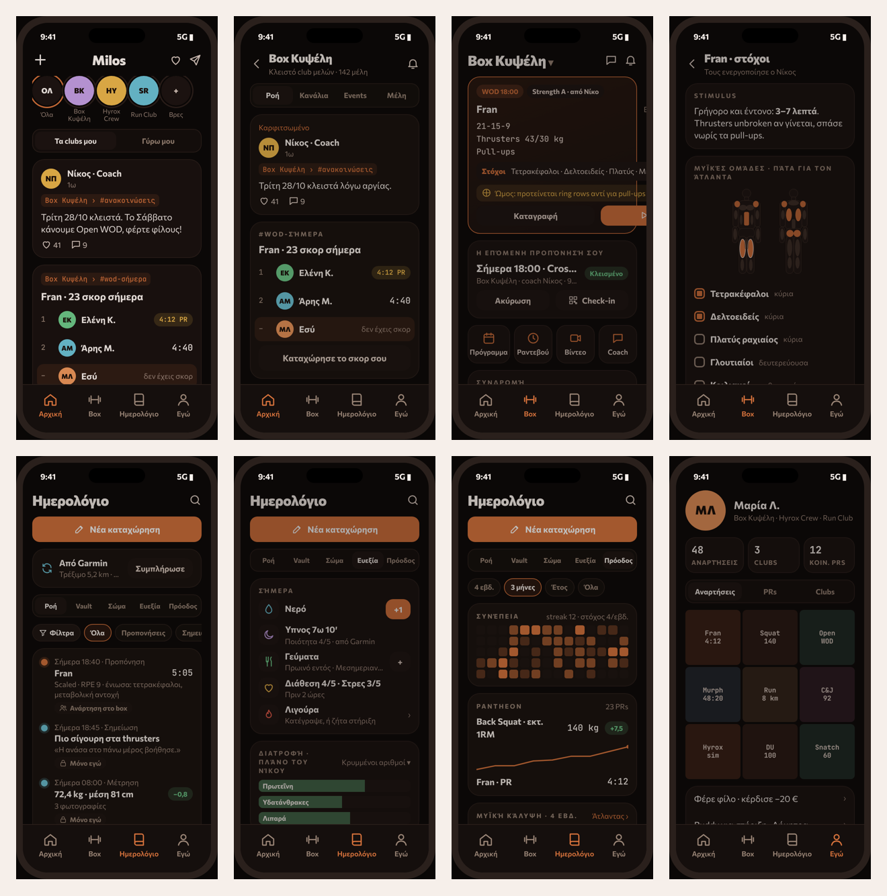

# Palee: product vision, information architecture & build brief

> **Read this first if you are an agent or developer picking up product work on Palee.**
> This document captures the outcome of a long product discussion (Oct 2026) about *what Palee is*, *who it is for*, and *how the member-facing app must be organized*. It is both a business brief and an engineering brief. When in doubt, the principles in §4 win.

**Mockups (open in a browser, fully clickable):**
- [`mockups/palee-ia-mockup.html`](mockups/palee-ia-mockup.html): **the final design.** 34 navigable phone screens, sitemap, coverage tables, interactive anatomy atlas.
- [`mockups/palee-bottom-bar-exploration.html`](mockups/palee-bottom-bar-exploration.html): **SUPERSEDED. Do not implement anything from it.** It records the 13 rejected bottom-bar options (including a «Σήμερα» tab, adaptive screens, an AI-coach tab and a 4-button «⊕» bar) only to explain *why* the final design looks the way it does. Wherever it conflicts with this document or `palee-ia-mockup.html`, those win.
- [`mockups/screens/`](mockups/screens/): PNG of every screen (2×). The overview is below.



> The mockups use the app's own design tokens (`apps/web/src/app/globals.css`: `--bg #0B0807`, `--primary #D9743D`, …) and Greek UI copy, because the primary market is Greek. All copy must still go through the existing i18n layer (`apps/web/src/i18n`).

---

## 1. TL;DR

Palee is **gym-management software that turns the gym into a living club**: a place members open every day, and one that opens itself in a controlled way to the neighbourhood to bring in new clients.

- For **gym owners and independent trainers** (the paying customer): run the business (bookings, packages, finance, coaching), **keep members longer** (community, progress, accountability) and **bring in new members on their own terms** (open events, trials, referrals). There is no discount marketplace.
- For **athletes and members** (the daily user): one app for **my people** (feed and clubs), **my gym** (book, train, pay, ask the coach) and **me** (a private journal of training, body and mind).

The member app has **four bottom tabs: `Αρχική` (Feed) · `Box` · `Ημερολόγιο` (Journal) · `Εγώ` (Me)**. The feed is the landing screen. Every object has exactly one home tab.

---

## 2. The problem we solved

The original idea had a blurry identity. Palee was three products at once: a gym-management SaaS, a gym-oriented social network (including Tinder-style gym-buddy matching), and a personal training journal, plus a "canonical place to access your gym". The question was whether that is a sellable product or an unsalvageable mess.

**Verdict: it is sellable, as long as the three identities are given a hierarchy and a sequence instead of being presented as equals launched simultaneously.** The key insight is that this is a **B2B2C** product:

1. The gym buys the software (B2B revenue, from day one).
2. Its members *must* install the app to book and pay (distribution, with no paid user acquisition).
3. Once inside, the journal gives single-player value (retention without a network), and the gym's club gives social value **without a cold start**, because the members already know each other.
4. Only then does the platform open outward (open clubs, events, "Γύρω μου"), creating the pool of potential clients that gym owners can "fish" from.

Social networks die of cold start. Palee avoids it because every gym that signs up brings a ready-made, real, verified community.

### How we got to the final layout (short history)
We explored 13 bottom-bar options (see the exploration mockup): social-first, journal-first, gym-first, every pairwise hybrid, three "all equal" variants, an adaptive time-of-day home, a clubs-first model, an AI-coach-first model, and a 4-button synthesis. The product owner then set **hard constraints** that shaped the final IA:

- **Landing = Feed** (Instagram-like), so the social identity is visible on open.
- **Box and Journal must each have a prominent, permanent place** in the bottom bar.
- **No adaptive screens.** Everything must be predictable and stable. (An earlier "Σήμερα / Today" tab that changed by time of day was rejected as confusing and low-value.)
- **No "More" button** (it fogs the identity).
- Clubs should be **inside the feed**, not a separate product.
- Gym buddies: swipe was reconsidered (see §7.3).

---

## 3. Market, trends & the opportunity

Researched Oct 2026. Many figures come from interested parties (vendors, Strava, ClassPass), so treat them as directional.

| Signal | Evidence | What it means for Palee |
|---|---|---|
| **Community = retention** | ACSM's 2026 trends added "Adult Recreation & Sport Clubs" for the first time, citing desire for social connection. Gym vendors (SugarWOD, Trainerize, Exerp) push community features as a retention lever. | The club/feed is not a B2C toy. It is our strongest **B2B retention pitch**. |
| **Small groups > followers** | Strava reports running clubs grew ~3.5× in 2025. Gen Z uses run clubs to meet people, as an alternative to burnt-out dating apps. | Social is organized around **clubs, crews and "η ομάδα των 07:00"**, not follower counts. Gym buddies work better as groups. |
| **Fitness racing / hybrid** | Hyrox: ~1.3–1.5M participants in 2025–26, waitlists in Paris, ~3× growth in Shanghai. World Triathlon approved it as "Hyathlon". | Gyms will sell **seasons** (Hyrox prep, 12-week challenges), not just memberships. Crews train for races together. |
| **AI layered on human coaches** | Vasa, NYSC and Hotworx launched AI personal training in 2026, always refining trainer-built programs. Analysts note manual loggers (e.g. Hevy) risk losing users to AI-automated logging. | Manual logging is becoming a commodity. Differentiation moves to **community + the gym relationship**. AI belongs as the coach's assistant, not as a tab. |
| **Software + client pool is proven** | Playlist (Mindbody + ClassPass) merged with EGYM ($7.5B, closed Mar 2026). ClassPass says 94% of its users are new to the venues they visit. Studios complain about discount-driven devaluation. | "We bring you clients" works, but there is a gap: **bring clients without a discount marketplace**, with the owner controlling the offer. |
| **Europe headroom** | 75.5M members (+5.8%), €39.1B revenue (2025). Penetration 9.3% vs 24.9% in the US. No Greece-specific data found. | Independent gyms in markets that big players underserve (language, local payments and invoicing) are a real wedge. Get Greek numbers from the Panhellenic Gyms Association. |
| **Gym-buddy apps** | Many small swipe apps (GymBuddy, DUFIT, SpotYourMatch, SwipeFlex). Users ask for verification and safety. None at scale. | Our unfair advantage: **the gym has already verified its members.** Matching inside a club is safer than any stranger app. |
| **Wearables #1** | ACSM 2026: wearables #1, mobile exercise apps #4, exercise for mental health up to #6. | Auto-fill the journal from devices. Our wellbeing features tie into mental health. |

### The gap we fill
> The big players are either **discount marketplaces** (ClassPass), **global follower networks** (Strava, Hevy), or **soulless management software** (Glofox, PushPress; SugarWOD's community stops at the gym's walls). **Nobody turns the gym into a club of real, verified people that opens, under the owner's control, to its neighbourhood.**
>
> **Palee = the gym as a club.** Verified members, open events for the neighbourhood, and the client relationship stays with the owner.

### Our predictions (opinion, not data) for 2027–28
1. Logging becomes near-automatic (voice, wearables, AI). The journal is necessary but no longer differentiating. **Community and the gym relationship become the moat.**
2. Social fitness concentrates in small groups (clubs, crews, time-slot groups). Public follower feeds stay with Strava.
3. Market consolidation (Playlist + EGYM) pushes independent gyms to look for alternatives that don't compete with them for their own clients.
4. Gyms sell **seasons**. The app that supports seasons sells packages on the owner's behalf.

---

## 4. Product principles (non-negotiable)

1. **Every object has one home.** It is created and edited in exactly one tab. Elsewhere it appears only as a card that links home (§6.3).
2. **Stable, predictable screens.** Content refreshes, but card order never changes. A card with nothing in it is hidden, not shown as an empty state (ANR 2026-10-24): on Feed no WOD, no events, no challenges or no posts means no card. Box without a membership at any box or coach shows only «Βρες box» (near me in Γύρω μου, or by name, ADR-221).
3. **⊕ means "post for others".** It exists only on the Feed, in the top bar next to the bell (owner, 2026-10-24). Writing for yourself is always a labelled button: `Νέα καταχώρηση`, `Καταγραφή`, `Έναρξη`. No unlabelled `+` anywhere else.
4. **Comparison with others lives in clubs and is opt-in. Comparison with yourself lives in the Journal.**
5. **Private by default.** Notes, body data, photos and cravings are private unless the user explicitly widens visibility (§8.2). Injuries are the one exception: each injury a member records carries «Να το δει το box μου», on by default, so management and the coaches who train them see it for safety unless the member turns it off; every staff read is logged for the member (ADR-286). Injuries a box records itself are always the box's.
6. **Club ≠ Box.** The same gym plays two roles: a *social space* (Feed: talk, see, participate) and a *service relationship* (Box: book, train, pay, ask). Never mix them.
7. **Swipe only for people, and only with mutual consent.**
8. **No "More" drawer.** Secondary things live in `Εγώ`. Gym things live in `Box`'s action row.
9. **The journal belongs to the athlete, not to the gym.** It follows them across gyms and coaches.
10. **Do no harm with body and food data** (§8.6).

---

## 5. Audiences, value propositions & go-to-market

### 5.1 Segments
| Segment | Pays? | Job to be done | Primary pitch |
|---|---|---|---|
| **Gym owners** (boutique, CrossFit/functional, martial arts; class-based with strong community) | Yes, SaaS | Run the gym, keep members, get new ones | v1: "Τα μέλη σου μένουν γιατί είναι κοινότητα." v2: "Φέρνεις νέους πελάτες με τους δικούς σου όρους." v3: "Πουλάς προγράμματα, όχι μόνο συνδρομές." |
| **Independent personal trainers** | Yes, smaller tier | Manage clients, programs, sessions, packages; find clients | "Your practice in one app, plus a club and open bootcamps to grow." A **second B2B market**: many later open their own studio. |
| **Members** | No (maybe premium later) | Book, train, track progress, belong | "Η προπόνησή σου, το box σου, η παρέα σου." |
| **Athletes without a gym** | No | Track training, find people and places nearby | Free journal + Γύρω μου. **They are the pool gyms fish from.** |

### 5.2 Sales objections & answers
- *"Will my members see the competitor across the street?"* Inside the app, a member's default feed is **their clubs**. Discovery (`Γύρω μου`) is user-initiated and shows **events and trials**, not poaching ads. Owners never message other gyms' members.
- *"ClassPass destroyed my prices."* No credits and no marketplace discounts. **You** set trial slots (e.g. 2/week, 1 free session per person) and event prices.
- *"My members won't use another app."* They must use it to book, and they come back for the community, their progress and their coach.

### 5.3 Monetization
- SaaS subscription per gym (tiers by members/features). A smaller tier for solo coaches.
- Later: promoted events / featured placement in `Γύρω μου` (clearly labelled), and paid seasons/programs with a revenue share.
- Possible athlete premium (advanced analytics). **Never paywall the basics.**

### 5.4 Success metrics (instrument from day one)
- Member weekly actives; opens/week of `Αρχική` vs `Box` vs `Ημερολόγιο`.
- Gym retention: churn and cancellations of members in gyms with active clubs vs without.
- Logging rate: % of attended classes with a score/log; % of logs started from `Box`.
- Community: posts/comments per club per week; % of members in ≥1 channel beyond defaults.
- Acquisition (v2+): open-event attendees → trial → paid conversion; referral conversions.
- Safety/health: reports, blocks; opt-out rates for body/food tracking (a signal we're doing harm if high).

---

## 6. Information architecture

### 6.1 Bottom bar (4 tabs + notifications, fixed)
> **2026-10-23 (owner):** the tabs are named **Feed** (was Αρχική) and **Journal** (was Ημερολόγιο) in every locale's own word, routes unchanged; the bar floats (side margins, rounded, see-through) and holds **Feed · Box · Journal · 🔔 Ειδοποιήσεις · avatar (Εγώ)**, so the bell moved from the Feed header into the bar, next to the avatar.

> **2026-10-24 (owner, decision card):** Instagram-like. The bottom bar holds **Feed · Box · Journal · Μηνύματα · avatar (Εγώ)**: Μηνύματα (line speech bubble with the unread count of the one inbox, ADR-196) opens `/messages` from every tab. A **top bar** carries the Palee logo on the left and the bell on the right; on the Feed only, `⊕` sits next to the bell. The top bar shows wherever the bottom bar does, hides while scrolling down and returns on any scroll up or near the top (not with reduced motion); the page group's tab strip rides with it. Icons are line icons, never emoji.

| Tab | Answers | Landing content |
|---|---|---|
| **Feed** *(landing)* | "What are my people doing?" | Top bar: Palee (left) · `⊕` new post · bell (right); Μηνύματα is in the bottom bar (owner, 2026-10-24). Club bar (stories-like): Όλα · my clubs · + Βρες. Scope toggle: **Οι δικοί μου \| Γύρω μου**. Feed. |
| **Box** | "Where and with whom do I train?" | Today's workout card (**Καταγραφή / Έναρξη ▶**), next booking (+ QR check-in), actions (Πρόγραμμα · Ραντεβού · Βίντεο · Coach), membership, announcements. |
| **Journal** | "How am I doing?" | `Νέα καταχώρηση` button, device sync card, segments **Ροή · Vault · Σώμα · Ευεξία · Πρόοδος**. |
| 🔔 **Ειδοποιήσεις** | "What needs me?" | Not a tab: opens the inbox over the current screen; unread badge. |
| **Εγώ** (Me, the avatar) | "How others see me + my settings" | Public profile (Αναρτήσεις · Πολυμέσα · PRs · Clubs) + a list: Φέρε φίλο, Φιλαράκι στήριξης (Check-in buddy), Τα box και τα clubs μου, Κοινοποίηση & ορατότητα, Συνδεδεμένες συσκευές, Πληρωμές, Ρυθμίσεις, Βοήθεια (+ staff entry to admin). |

Messages live top-right in the Feed. `Box › Coach` opens the same inbox filtered to the coach. Alternatives considered: 3 tabs with an avatar; 5 tabs with Clubs; 5 tabs with Messages. Revisit **5 tabs with Clubs** only if the average member is in ≥3 clubs and events become a core use.

### 6.2 Sitemap
```
Αρχική
├─ ⊕ Νέα ανάρτηση (audience: club›channel | followers | public; attach workout from journal)
├─ top bar: Ειδοποιήσεις (bell) · bottom bar: Μηνύματα (Όλα | Coach | Clubs | Partners)
├─ Club bar → Club page (member):  Ροή · Κανάλια · Events · Μέλη(Partners)
├─ Box page (non-member):          Σχετικά · Πρόγραμμα(read-only, trial slots) · Events · Δημόσια · [Ζήτα δοκιμαστικό] [Ακολούθησε]
└─ Γύρω μου: events · open clubs · boxes with trials · public posts · Φίλτρα(n) · saved filters

Box   (title ▾ switches provider: gym or independent coach)
├─ Workout of the day → Καταγραφή | Έναρξη ▶ (existing execution screen) | Στόχοι → Άτλαντας
├─ Next booking → Check-in (QR) · Open gym
├─ Πρόγραμμα (book, waitlist, guest pass, locations, ICS export, filters)
├─ Ραντεβού · Βίντεο
├─ Coach: sessions · programs (reject/reschedule/request) · form reviews · nutrition · messages
├─ Συνδρομή: remaining allowances · renew · corporate plan · seasons
└─ (coach role) Πελάτες μου: reply queue, form reviews, programming, coach notes, class timer, check-in

Ημερολόγιο
├─ Νέα καταχώρηση: Προπόνηση | PR | Μέτρηση | Νερό·Ύπνος·Γεύμα | Πώς νιώθω | Λιγούρα | Τραυματισμός | Βίντεο τεχνικής | Αξιολόγηση | Σημείωση
├─ Ροή (all entries, visibility badge on each, filters)
├─ Vault (completed workouts with dated entries, trend, Επανάληψη)
├─ Σώμα (measurement snapshots + photos, compare slider, charts)
├─ Ευεξία (Σήμερα card: water, sleep, meals, mood/stress, cravings; injuries; coach nutrition plan)
└─ Πρόοδος (time range; Pantheon; consistency heatmap; strength; muscle coverage; qualities radar; load; insights; export)

Εγώ
├─ Profile tabs: Αναρτήσεις · Πολυμέσα · PRs (shared) · Clubs
├─ Φέρε φίλο · Φιλαράκι στήριξης · Τα box και τα clubs μου
├─ Κοινοποίηση & ορατότητα · Συνδεδεμένες συσκευές (+ Wallet, ICS)
└─ Πληρωμές & αποδείξεις · Ρυθμίσεις · Βοήθεια & ξενάγηση · (staff) Διαχείριση → web console
```

### 6.3 Object homes
| Object | Home (create/edit) | Appears as a reference in |
|---|---|---|
| Post | Αρχική | Club page, Εγώ grid |
| Club, channel | Αρχική › club bar | Εγώ › Τα clubs μου |
| Event | Club › Events | Feed card, Γύρω μου |
| Partner match | Club › Μέλη › Partners | Messages |
| Messages | bottom bar › Μηνύματα (`/messages`: Όλα · Άτομα · Coach · Clubs · Partners; person conversations and requests under Άτομα; Partners only once the person has a training partner or check-in buddy; ADR-196 amended 2026-10-25) | Box › Coach (`?filter=coach`) |
| Class, booking, check-in | Box | Journal (after training) |
| WOD of the day | Box | Feed (#wod-σήμερα + leaderboard) |
| Membership/package | Box | Εγώ › Πληρωμές |
| Season | Box (purchase) | Journal (program), crew channel |
| Workout log | Ημερολόγιο | Post attachment, WOD leaderboard |
| PR | Ημερολόγιο › Πρόοδος (Pantheon) | Εγώ (only PRs chosen per PR in Κοινοποίηση; the rest counted as private, ADR-196), posts |
| Measurements, wellness, injuries, cravings | Ημερολόγιο | Never public. Coach only with permission (injuries: on by default, one switch per injury, ADR-286). |
| Profile, settings, payments | Εγώ | n/a |

---

## 7. Feature specifications

Legend: **[EXISTS]** reuse as-is, only needs a new home · **[PARTIAL]** data/backend exists, UI or logic missing · **[NEW]** must be built.

### 7.1 Feed & clubs [NEW]
- **Club bar** at the top of the feed (stories position). Tapping opens the club page.
- **Every post shows its origin**: `Box Κυψέλη › #wod-σήμερα`.
- **Scope toggle** (Twitter-like): `Οι δικοί μου` / "My people" (default; clubs + people you follow, Φιλαράκια included, + boxes you follow; renamed from «Τα clubs μου», ANR 2026-10-24) | `Γύρω μου` (**local**, not global). Newest first, never ranked. Remember the last choice.
- **Post format** (Instagram-like): optional media, text, **optional workout attachment from the journal**. Text-only posts allowed (announcements, questions).
- **Audience picker** on compose: club › channel | followers | public.
- **Club page (member):** `Ροή` (pinned announcement → WOD card with leaderboard → challenges → PR celebrations (opt-in) → events → member posts), `Κανάλια`, `Events`, `Μέλη` (coaches, members, Partners).
- **Box page (non-member):** `Σχετικά` (photos, disciplines, coaches, locations, hours), `Πρόγραμμα` (read-only, "Κλείσε με δοκιμαστικό" where the owner allotted trial slots), `Events` (open), `Δημόσια`. CTAs: **Ζήτα δοκιμαστικό**, **Ακολούθησε**.

**Channel governance**
| Channel | Created by | Who writes | Who's in |
|---|---|---|---|
| #ανακοινώσεις | Auto, with the gym | Staff only | All members (cannot leave) |
| #wod-σήμερα | Auto from schedule | System (WOD, leaderboard) + members (scores, comments) | All members |
| #challenges | Auto when the owner creates a challenge | Participants | Opt-in |
| #ομάδα-07:00 | Coach/admin, per recurring class | Group members | Frequent bookers of that slot (suggested) |
| #hyrox-prep (season) | Auto when a season is sold | Coach + participants | Buyers |
| PT squad | A coach | Coach + their clients | Invite-only |
| **Member group** (#τρέξιμο-κυριακής) | **Members**, if the owner allows | Group members | Open or request, per creator |
| Open club (Saturday Run) | Staff only (represents the business) | All in club | Anyone, including non-members |

Owner setting for member groups: **Όχι · Με έγκριση (default) · Ελεύθερα**. Moderation by creator + staff (report, archive). Auto-archive member groups after 60 days of inactivity.

### 7.1a Buddies, private accounts, messages and people search [NEW] (ANR 2026-10-24, ADR-193)
- **One concept: following.** People you follow who follow you back are **Buddies** (el «Φιλαράκια», de Kumpels, es Colegas, fr Potes, it Amiconi, nl Maatjes, pt Amigalhaços, ru Приятели, bg Приятелчета, ar رفاق, he החבר'ה). Derived, never managed separately; unfollowing ends it.
- **Counts line** under the name (Εγώ and every profile), Buddies first, three groups that never overlap: «35 Φιλαράκια · 85 σε ακολουθούν · 45 ακολουθείς» ("follow you" = not followed back; "you follow" = not following you back, requests included). Each part opens the matching Connections tab: Φιλαράκια · Σε ακολουθούν · Ακολουθείς · Boxes · Clubs · PRs. A «Buddy» badge on profiles and rows.
- **Public and searchable by default** (ANR 2026-10-25, ADR-193 amended; was private by default). `Κοινοποίηση & ορατότητα › Ιδιωτικός λογαριασμός` (off): people follow at once. On: a follow is a request; turning it off again accepts waiting requests. `Εμφάνιση στην αναζήτηση` (on). Accounts that already stored a choice keep it. Content stays private by default (§4 principle 5): the account setting only decides who may follow.
- **Messages between people** need no shared gym. Buddies, people in a shared gym/open club, and people who follow you reach your inbox; anyone else lands in **Αιτήματα μηνυμάτων** (accept, reply or decline; a decline is silent). Blocks apply everywhere. A «Μήνυμα» button on every profile. The gym's own threads (box, coach, class) stay separate (Club ≠ Box). They show together in the one inbox (Μηνύματα).
- **Messages to a box** (ANR 2026-10-30, [ADR-282](../adr/ADR-282-box-inbox-anyone-writes-to-a-box.md)): anyone with an account writes to a published box («Μήνυμα» on its page); a member also reaches their own box when the page is not published. Every «Επικοινωνία με το box» opens the chat with the topic preset (Πληρωμές → Πληρωμή). The box answers from one shared inbox worked out from the roles (whoever holds `message_from_box`), in Μηνύματα › Box with «Αναπάντητα» and «Όλα»; no setting. Coaches are the contact point for training: «Προπόνηση» goes to the person's coaches (or the head coaches), and «Φέρε τον coach» brings any coach in. Everyone in the inbox is notified until someone answers, then only who answered. A «Νέος» (never a client) waits after three unanswered messages and can be blocked; clients never.
- **People search** across Palee by @handle or name, as the person types and forgiving typos (trigram similarity from three characters, literal matches first; club search in «Βρες» does the same; ANR 2026-10-25): shared clubs first, then Buddies, follows, public people nearby, then anyone public. Private people, or people who turned search off, show only to people they already know.
- **Box search by name** (ADR-221, 2026-10-28): the same «Βρες» field finds boxes and independent coaches by name (accents, case and Latin spelling ignored, typos forgiven from three characters), in a «Box και coaches» card shown only on a match. Only live businesses with a published public page answer; a map point is needed only for Γύρω μου. Activation does not publish the page: the activation screen, the gym setup checklist (step «Δημοσίευσε τη δημόσια σελίδα σου») and the page editor (with «Διεύθυνση στον χάρτη») all say it is the next step.

### 7.2 Γύρω μου & filters [NEW / PARTIAL]
One pattern everywhere: a **chip row under the title, with `Φίλτρα (n)` first**, which opens a sheet. Filters are remembered. Combinations can be saved ("ΣΚ κοντά").
| Surface | Filters |
|---|---|
| Γύρω μου | **radius, neighbourhood or map**, discipline, what (events/clubs/boxes/posts), when (a **From / To date picker** above the shortcut chips today, tomorrow, weekend, this week; plus morning, midday, evening), cost (a **price range slider** above the shortcut chips free, up to €15, trial), level, language, audience (women, 40+, beginners), accessibility |
| Box › Πρόγραμμα [PARTIAL] | location, class type, coach, time, only with spots, only covered by my package |
| Partners | level, time, goal, discipline, optional gender preference (safety), distance in open clubs |
| Feed/club | club, channel, type (announcements, PRs, events), coaches only |
| Journal | entry type, visibility, date range, source (box/coach/freeform), text search |
| Vault | discipline, benchmark, exercise, date |
| Πρόοδος | time range, provider, exercise |

In the Γύρω μου sheet, «Πότε» and «Κόστος» each open with a picker and keep their chips underneath as shortcuts (ANR, 2026-10-24). The pickers and the chips edit one value: a chip replaces what the picker chose and the other way round (picking dates clears today/weekend; «Δωρεάν» or «Έως €15» replaces a hand-picked price range; «Δοκιμαστικό» is independent). A date range is at most 62 days; the price slider's ends mean «no limit». The chip row itself stays «Φίλτρα (n) · Τα αθλήματά μου · Πότε · Δωρεάν».

Every other list uses the same `ListFilters` row + sheet, remembered per surface (ADR-197, 2026-10-24): Find (kind, box), events (club, free, going), videos (tags), appointments (kind, format, coach), my workouts (status, kind, season), reviews (subject, feeling), my posts (club, type). A filter shows only the choices the list actually has, so none is ever empty. «Επίπεδο» in Γύρω μου means the box runs classes at that level, and posts drop out. Partner distance exists only in open clubs, between people shown in Γύρω μου, measured from neighbourhood to neighbourhood.

### 7.3 Partners (gym buddies) [NEW]
Why swipe works for people and not for clubs: swipe makes sense when **both sides must agree**, options are many, and the decision is quick. Clubs fail all three. An open club needs no approval, a neighbourhood has 10–20 of them, and joining a gym is not a snap decision. Therefore:
- Swipe **only among members of the same club** (verified by the gym), with **mutual** match → message → "Κλείστε μαζί 07:00".
- Clubs: `Μπες`. Events: `Θα έρθω`. Boxes: `Ζήτα δοκιμαστικό` (owner accepts within allotted capacity).
- Frame as **training partner**, never "match/date". Filters: time, level, goal.

### 7.4 Box: the workout card [EXISTS + PARTIAL]
- **First card, always:** today's workout preview. If there are several (class WOD + coach program), show source **chips** (`WOD 18:00 · Strength A · από Νίκο`).
- Two buttons: **Καταγραφή** (log score/RPE/notes without the app's timer) and **Έναρξη ▶**, which opens the **existing execution screen** (timer, auto-progressing steps, modifications, per-exercise notes). **The execution screen does not change at all.** On finish, the result lands in the Journal.
- Injury warning (existing `InjuryWarnings`, acknowledge flow) shows above the buttons when relevant.
- **Στόχοι** row → goals screen (§7.6).

*Decision (ADR-226, 2026-10-28):* a class without automatic confirmation shows members «Απαιτεί έγκριση · απάντηση μέσα σε …» (or «έως την έναρξη» when the box set no limit). It never shows a booking deadline: bookings stay open until the class starts. Late cancellation is set in hours and minutes.

### 7.5 Check-in with QR (fewest taps) [PARTIAL]
| Method | Taps | Web? | Notes |
|---|---|---|---|
| **Rotating QR at the door** (on the existing check-in desk / display), scanned with the phone camera | 1 scan | Yes | Token rotates every ~30 s, so screenshots don't work. Deep link performs check-in. |
| **Apple/Google Wallet pass** scanned by the desk | 0 in-app | Yes (server-generated pass) | Double-press side button, show pass. |
| In-app Box › Check-in personal QR | 2 | Yes | Fallback. Full-screen, brightness up. |
| Geofence notification | 1 | **No** | Needs native. |

**Scan resolution logic:** booking within −30′/+15′ → check in to it. Else open-gym check-in if the package allows. Else, for a non-member, "Θες δοκιμαστικό;" (**the door becomes an acquisition surface**).

### 7.6 WOD goals & anatomy atlas [NEW, data PARTIAL]
- Coach toggle in the workout editor: **"Εμφάνιση στόχων στα μέλη"**. Goals are auto-suggested from the exercises and editable by the coach.
- Goals = **muscle groups** (front/back figure, primary/secondary/stabilizer), **fitness qualities** (the 10 general physical skills: cardiorespiratory endurance, stamina, strength, flexibility, power, speed, coordination, agility, balance, accuracy), and **stimulus** text ("γρήγορο, 3–7′, unbroken thrusters").
- **Checklist semantics:** before the workout they are goals. In the log afterwards, the athlete ticks what they *felt*, and this feeds `Πρόοδος` (muscle coverage, qualities radar).
- **Atlas:** 3 levels, region → muscle group → head/muscle. Each shows what it does, the athlete's own sets over the last 4 weeks (coverage level), and exercises from the gym's library with videos. It has a heat-map mode. Reachable from goals and from `Πρόοδος › Μυϊκή κάλυψη`. A working prototype is in the mockup (§ "Στόχοι WOD").
- **Data already in the repo:** `exercise_catalog_entries` has `muscle_groups`, `movement_pattern`, `skill_domain` (`apps/api/lib/palee/analytics/exercise_catalog_entry.ex`). The injury-risk policy maps exercises to movement patterns and body regions, primary and secondary (`apps/api/lib/palee/wellbeing/domain/injury_risk_policy.ex`). Reuse these; don't invent a parallel taxonomy.

### 7.7 Journal [EXISTS + NEW]
**`Νέα καταχώρηση`** (grouped sheet): Προπόνηση · PR · Μέτρηση · Νερό/Ύπνος/Γεύμα · Πώς νιώθω (mood, energy, stress) · Λιγούρα · Τραυματισμός · Βίντεο τεχνικής (form review, quota) · Αξιολόγηση (rating) · Σημείωση (technique, thought, mood, goal; can link to a workout).

**Visibility ladder** (shown as a badge on every entry):
1. **Μόνο εγώ**: default for notes, mood, body, cravings, and personal workouts outside a gym.
2. **Ο coach μου μπορεί να το δει**: default for workouts and PRs done in a gym; no notification (today: PR coach visibility, training log in the athlete profile).
3. **Ζητάω απάντηση**: enters the coach's reply queue, answer arrives in messages (today: execution notes, reply queue, form reviews).
4. **Αξιολόγηση**: rating 1–5 + sentiment, to coach/box (today: reviews with `admin_only` / `user_visible`).
5. **Ανάρτηση**: becomes a post (club/followers/public).

Coach notes about an athlete (`/staff/clients/{id}/coach-notes`, read-audited) stay **staff-only, never shown to the athlete.**

**Segments:**
- **Ροή:** every entry chronologically, with filters.
- **Vault:** completed workouts, each with dated entries + trend + `Επανάληψη` (→ execution) [EXISTS: `/api/executions/vault`].
- **Σώμα [NEW]:** measurement **snapshots** (weight, body-fat %, waist/hips/chest/arm/thigh, optional front/side/back photos). The camera shows a **ghost outline of the previous photo** so the pose is the same. Compare slider between two dates, chart per metric. Photos are **always private** unless explicitly shared with the coach. Never posted without a separate confirmation.
- **Ευεξία [NEW]:** `Σήμερα` card with one tap per item: water (+1 glass, daily goal), sleep (hours + quality or from device), meals (in/out of plan, optional photo; macros vs the coach's plan, which can be hidden), mood/stress, **Λιγούρα** (intensity, trigger: stress/fatigue/boredom/social/hunger, outcome, **"Χρειάζομαι στήριξη"**). Week strip. Injuries [EXISTS] and the coach's nutrition plan [EXISTS] are referenced here.
- **Πρόοδος:** fixed section order with a time range on top. See the analytics table.

**Analytics catalog**
| Metric | Shows | Data | Status |
|---|---|---|---|
| Consistency | calendar heatmap, streak, weeks on target | log, executions | EXISTS |
| Perseverance | adherence to programmed work | executions, modifications | EXISTS |
| Strength | estimated 1RM per lift over time | logged loads, PR history | PARTIAL |
| Benchmarks | Fran/Murph/2k row trends, "retest due" | PR history, Vault | PARTIAL |
| Volume by modality | strength/gymnastics/aerobic/flexibility/recovery | workout categories | PARTIAL |
| Muscle coverage | sets per group, push/pull and quad/ham balance | `muscle_groups`, `movement_pattern` | NEW view |
| Qualities | radar of the 10 skills | WOD goals, `skill_domain` | NEW |
| Training load | sRPE (RPE × minutes), acute:chronic ratio as an overload *indicator* | `perceived_effort`, `duration_seconds` (exist) | NEW view |
| Sleep ↔ performance | "PR 2.4× more often after 7h+ sleep" | sleep, scores, PRs | NEW |
| Time of day | when you perform best | log timestamps, scores | NEW view |
| Body | measurement trends, photo compare | snapshots | NEW |
| Cravings | frequency, triggers, time, link to sleep/stress | craving log | NEW |
| Hydration | % days on target | water | NEW |

Show correlations only after enough data (e.g. ≥4 weeks), and always as **indicators, not medical advice.**

**ADR-194 (Πρόοδος / Ευεξία polish):**
- Πρόοδος has no page title. The range chips come first and drive every card, including resting HR, which has no chips of its own.
- Consistency is a single card holding the heatmap, the target and weeks on target. There is one streak only (a gym day streak, otherwise weeks).
- **ADR-229 (ANR 2026-10-28):** the weekly target is the person's own «Εβδομαδιαίος στόχος», set in `Εγώ › Ρυθμίσεις › Πρόγραμμα προπόνησης`. Their coach (or staff who coach every client) may set it from the client's profile; the person is notified and keeps the last word. Front desk and other roles never. Box settings keep only the streak shields per renewal (0–5) and when they renew.
- Cards with no data are hidden, never shown as placeholders.
- PR trends show estimated 1RM (Epley, ≤12 reps) and a retest hint after 84 days. Both come from one pure lib.
- The member can hide the macros of the coach's plan. This is stored server-side (`hide_macros`). With no plan, no card is shown.
- In Ευεξία, mood and stress are one tap each. The injury form opens from a button in a dialog. There is no second title.
- Every touch target is at least 44px; the `hit-area` utility enlarges small controls.

### 7.8 Check-in buddy · «Φιλαράκι στήριξης» [NEW]
Renamed from «Buddy για στήριξη» (ANR 2026-10-24), because Buddies («Φιλαράκια») now means mutual follows (§7.1a). One or two trusted people (a partner, friend, or the coach), set in `Εγώ › Φιλαράκι στήριξης`, with mutual acceptance. They receive **only what the user explicitly sends** via "Χρειάζομαι στήριξη" (nothing automatic). Notification with quick replies ("Είμαι εδώ", "Πάμε βόλτα;", "Πάρε με τηλέφωνο"). Optionally a weekly summary with counts only. Either side can leave at any time. The coach can get a **weekly summary** only with permission.

### 7.9 Referral for members [PARTIAL]
Today the backend has admin-only referral programs, referral events and rewards with statuses (`/admin/finance/referral-programs|referrals|referral-rewards`). Build the member side:
- `Εγώ › Φέρε φίλο`, also from `Box › Συνδρομή`: **personal link + QR**, and "invite to event" (Open WOD is the easiest first step).
- **Automatic attribution** via the existing join-link flow. Stages: signup → trial → paid.
- The reward is created from the active program and approved by the admin as today. The member sees their invites and rewards.

### 7.10 Personal training [EXISTS + PARTIAL]
**Principle:** `Box` shows **everyone who provides you training**. An independent trainer is effectively a one-person organization (owners can already create organizations: `POST /api/organizations`).
1. **PT with a gym coach:** `Box › Coach` = next session, coach programs (reject/reschedule/request [EXISTS]), form reviews [EXISTS], nutrition [EXISTS], messages. The journal's visibility ladder controls what the coach sees. Optional PT-squad channel.
2. **Independent trainer:** Box title "Νίκος Π. · Personal coach ▾". Same layout: program of the day (Καταγραφή/Έναρξη), next session (park/online/gym), Συνεδρίες · Βίντεο · Διατροφή · Μηνύματα, session package. The trainer grows with a club ("Team Νίκος") plus open bootcamps in `Γύρω μου`.
3. **Both:** switch providers from the Box title ▾. Today's card merges items from both, with source labels. **One journal.**

**Engineering gap:** PRs and injuries are account-scoped (`/api/prs`, `/api/wellbeing/*`), but the training log is org-scoped (`/api/org/{slug}/me/training-log`). A unified journal needs a cross-organization read model over all the athlete's memberships.

*Decision (ANR 2026-10-28, ADR-230):* staff can set a **WOD ημέρας** for a date, for every class or for chosen class types. The day's classes follow it, including classes added later that day; a class's own WOD overrides it, and «Επαναφορά στο WOD ημέρας» undoes that. It is set from a strip under each day's header in the schedule's day and week views (a quiet «+ WOD ημέρας» on days with classes, from today on), shown as one line in the month grid, and from the library's «Ανάθεση → Ημέρα». Before saving, the dialog says how many classes take it, which keep their own WOD (with «Να πάρουν κι αυτά»), and which already started. Classes that follow a day WOD are not drafts and send no missing-WOD alerts. Days are the gym's own days.

*Decision (ANR 2026-10-29, [ADR-270](../adr/ADR-270-structured-wod-plan.md)):* writing a WOD stays **Ελεύθερο κείμενο** by default; a visible toggle switches a workout to **Δομημένο**, a wizard per section (Ροή → Χρόνος → Ασκήσεις → Σκορ). A section has one **Ροή** (Σετ, For Time, AMRAP, EMOM, Intervals, Ξεκούραση), a **Δομή σετ** per exercise or group (Απλό, Superset, Complex, Cluster, Drop set, Rest-pause) and optional **Προσθήκες** (διακοπή κάθε Χ, ξεκούραση μέχρι να πέσουν οι παλμοί); Tabata, Death by, EDT and the other known names are **Έτοιμες μορφές** that fill these in. Values are kept as the coach typed them (ranges, decimals, words, `+5`, `60→80`), per set or **ανά γύρο** in every flow, with optional **Παράμετροι** (tempo, RPE, ρυθμός…). Fully keyboard-operable; on phones every exercise is a card. Members see the same plan read-only and run it in Έναρξη.

*Decision (ANR 2026-10-29):* a class's detail sheet for staff is titled with the class's own name (the WOD's title moves to the WOD card), then its time. Its state notice carries the way back: «Επαναφορά τμήματος» sits inside «Αυτό το τμήμα ακυρώθηκε», «Συνέχιση κρατήσεων» inside the paused notice. Only «Επεξεργασία τμήματος» stays in view beside ⋯ (Αντίγραφο, Προσθήκη στο ημερολόγιο, Παύση κρατήσεων, then Ακύρωση τμήματος and Διαγραφή); members keep a quiet calendar button, and a cancelled class offers none. Only a single class without a WOD (a draft, hidden from clients until it gets one) shows a red warning card right under the actions, with «Διάλεξε WOD» and «+ Νέο WOD». A series class without its WOD stays visible and bookable and staff already get reminders (07:00 and an hour before), so it shows no warning: the WOD card offers the same two buttons calmly. Warnings appear only when something is actually wrong. The attendee-variation action reads «Ξεχωριστό WOD για άτομα», shown whole, and the WOD card's buttons take the full row on a phone.

**Coach role in the same app:** `Box › Πελάτες μου` (reply queue, form-review queue, programming, coach notes, nutrition editor, class-timer control, check-in desk). The full admin stays in the web console (finance, users, schedule, workout library, challenges, content, metrics/reports, inventory, cleaning, settings), entered from `Εγώ › Διαχείριση`.

*Decision (ADR-198, 2026-10-24) [PARTIAL]:* `Πελάτες μου` is a Box extension shown only to someone with the coach role at the selected provider (a solo coach is owner and coach). It has four parts, each hidden when empty, and the whole section is hidden when all are empty. **Περιμένουν απάντηση**: each row opens the thread. **Αξιολόγηση τεχνικής**: a sheet with the video and the console's own feedback form. **Check-in σήμερα**: today's classes and sessions the coach leads, with «Ήρθε / Δεν ήρθε» per person. The staff roster now carries each booking's attendance. **Πελάτες**: chips that open the client's console profile, which stays the client's one home. Programming, coach notes, nutrition and the class timer stay in the console for now.

### 7.11 Εγώ [EXISTS + NEW]
Profile tabs (Αναρτήσεις grid · Πολυμέσα · shared PRs · Clubs) and a fixed list:

*Decision (ANR 2026-10-29, ADR-231):* every profile (a person's and Εγώ) has a **Πολυμέσα** tab after Αναρτήσεις, Instagram-like: a three-wide grid of square thumbnails of the person's posts with photos or a video, newest first, with a corner mark for a video (and its length) or several photos. A square opens the whole post over the grid. It follows the posts' audience exactly (public posts for everyone, followers posts once you follow; a private account's stay locked with the same note).

- **Φέρε φίλο**
- **Φιλαράκι στήριξης** (Check-in buddy, §7.8)
- **Τα box και τα clubs μου:** providers, per-club notification level, join by code/link.
- **Κοινοποίηση & ορατότητα:** what the coach sees, leaderboards/PR celebrations/challenges/partners opt-ins, PR share grants, default visibility for new entries.
- **Συνδεδεμένες συσκευές:** Garmin; Apple Health and Health Connect marked as coming with native; Wallet pass; ICS feed.
- **Πληρωμές & αποδείξεις:** per provider; invoices, refund receipts, corporate plan.
  The member owns their «Αυτόματη ανανέωση» (on by default when the package allows renewal) and can
  leave the box («Αποχώρηση από το box»); either way they keep what they paid for, only invoices for later
  periods or packages that never started are cancelled, and money owed for anything already used stays owed
  (shown and reminded) until paid. Staff can do the same from the box member's profile (ADR-220).
  - *Later (owner decision, 2026-10-23):* partner perks from outside stores in Προσφορές (TD-188) and a product shop/POS whose purchases appear in Συναλλαγές (TD-189) are post-MVP; the page leaves room for both.
- **Ρυθμίσεις:** language, theme, units, notifications, *journal sections on/off*, *show weight number or trend only*, offline sync status, account.
  *Decided 2026-10-28 (ADR-219):* «Οι ρόλοι μου» lets someone add or drop roles below their own top role at the selected box (an owner who also coaches adds «Coach» and stays owner). The top role is locked; the card is hidden for members and athletes, who have nothing below them. Others' roles change only downwards (vendor › owner › admin › staff › clients; co-owners manage each other).
  - *Notifications (ADR-199):* the card starts with push on this device, which moved here from Security. Below it is one row per category: bookings & classes, messages, clubs & community, coach, partners & buddies, journal reminders, and box operations (staff only). Each row has a switch for the bell and one for push. A push needs the bell on. Account & payments is always on and shown as locked. Everything is on until the person changes it. Each club's level is still set in Τα box και τα clubs μου.
- **(staff) Διαχείριση:** the last row of the list, shown to anyone with a staff role at any provider. One tap opens that provider's web console and remembers the console view on the device (ADR-103). *Decided 2026-10-24 (ANR asked how staff get back; ADR-196 amended):* it is its own row, not inside Βοήθεια, because the switch back must be findable.
- **Βοήθεια & ξενάγηση:** product tours; staff extras. Tours are interactive walkthroughs over the real screens (ANR 2026-10-24, ADR-193): a spotlight plus one short card per step, and the person taps the real button. They are listed at `/guides` (row «Οδηγοί» in Εγώ › Βοήθεια & ξενάγηση, ADR-196), offered once on a feature's home, and started again from a «Ξενάγηση» button in the header of a staff console. Progress is saved to the account. Shipped: Κατάστημα (staff), Διοργάνωση εκδηλώσεων, Οικονομικά › Προσφορές & Παραπομπές, and, for members, «Το δικό σου club και η δική σου εκδήλωση» (with a box as co-host or alone).
- *Decided 2026-10-24 (ADR-196):*
  - The list above is the whole list, in this order. Anything else moves into one of its pages:

    | Moved | Now in |
    |---|---|
    | Interests, Σώμα settings, business request, units, journal sections, rest days | Ρυθμίσεις |
    | Box switcher | Τα box και τα clubs μου |
    | Tour, first steps, how visibility works, contact the box, report a problem, coach practice, staff extras, password resets | Βοήθεια & ξενάγηση (`/me/help`) |

  - Chats have no row: the one inbox is Μηνύματα in the bottom bar.
  - Κοινοποίηση follows the mockup's blocks, plus a per-PR "show on profile" list.

---

## 8. Cross-cutting requirements

### 8.1 Existing feature → new home (nothing may be lost)
Every member-facing capability in today's code has a surface. The full ~50-row table is in the mockup ("Κάλυψη"). Highlights:
| Today (route/component) | New home |
|---|---|
| Home dashboard: Motivation, Perseverance, Training volume, streak (`landing-page.tsx`) | Ημερολόγιο › Πρόοδος |
| Seasonal challenges, opt-in leaderboard | Club channels (#challenges, #wod-σήμερα) + own progress in Πρόοδος |
| Recent completions, history (`/my-workouts/history`) | Ημερολόγιο › Ροή |
| "Κοινοποίηση στο Palee", shared PRs (ADR-129/132) | ⊕ post with attachment; Εγώ › PRs; Πρόοδος › Pantheon |
| My workouts, Classes, Appointments, Videos (`/my-workouts`, `/schedule`, `/appointments`, `/videos`) | Box (workout card, Πρόγραμμα, Ραντεβού, Βίντεο) |
| Journal: finished workouts, Pantheon, Progress, Coaching, Wellbeing | Ημερολόγιο (Ροή, Vault, Πρόοδος, Ευεξία) and Box › Coach |
| Workout execution (`/workouts/[id]/execute`, free-text execute) | Box › **Έναρξη** (unchanged) |
| Class timer display (`/class-timer/[slotId]/display`) | Box: next-class card becomes "Timer τάξης" while running |
| Guest pass, waitlist, open-gym check-in, locations, ICS export | Box › Πρόγραμμα |
| Entitlements, corporate enrollment, invoices, refund receipts | Box › Συνδρομή; Εγώ › Πληρωμές |
| Chat/threads, notifications/web push | bottom-bar Μηνύματα / top-bar bell |
| Gamification preferences, PR sharing grants & coach visibility | Εγώ › Κοινοποίηση & ορατότητα |
| Offline outbox, onboarding/tours, profile/avatar/language/theme | Εγώ › Ρυθμίσεις / Βοήθεια |

Current member navigation is defined in `apps/web/src/lib/role-navigation.ts` (Home · Training · Journal with ~10 sub-tabs). This document supersedes that structure for members.

### 8.2 Visibility model (suggested)
Use a single enum across entry types: `private | coach_can_view | coach_reply_requested | rated | posted(audience)`. Store `audience` separately for posts: `club_channel(id) | followers | public`. Injuries ignore `private` for coaches of active coaching relationships; a member's own injuries reach staff while their per-injury `shared_with_box` switch is on (ADR-286). Every coach read of sensitive data should be audit-logged, as coach-note reads already are (injuries: `injury_access_log`).

### 8.3 Suggested new entities (sketch, not final)
`Club(id, org_id?, kind: gym|open|member_group|pt_squad|season, visibility, join_policy)`, `Channel(id, club_id, kind: announcements|wod|challenges|class_slot|season|custom, write_policy)`, `ClubMembership(user, club, role, notify_level)`, `Post(id, author, audience, channel_id?, body, media[], attachment{type, id})`, `Event(id, club_id, starts_at, capacity, price, open_to_non_members, guest_pass_allowed)`, `TrialSlotPolicy(org_id, per_week, per_person)`, `PartnerProfile/PartnerSwipe/PartnerMatch`, `MeasurementSnapshot(user, taken_at, metrics{}, photos[], visibility)`, `WellnessEntry(user, kind: water|sleep|meal|mood|stress, value, at, visibility)`, `CravingEntry(user, intensity, triggers[], outcome, support_requested, at)`, `SupportBuddy(user, buddy, status, summary_opt_in)`, `ReferralLink(user, org, code)`, `WorkoutGoals(workout_id, muscles[{group, role}], qualities[], stimulus, visible_to_members)`, `GoalFeedback(log_entry_id, felt_muscles[], felt_qualities[])`, `SavedFilter(user, surface, params)`, `CheckInToken(location_id, rotating_secret)`, `WalletPass(user, org)`.

### 8.4 Platform constraints (the app is a Next.js PWA + Elixir API)
- **Web can do:** camera QR scanning (system camera → deep link), Wallet passes (server-generated `.pkpass` / Google Wallet), photo capture and upload, web push (exists), Garmin (cloud API), offline outbox (exists).
- **Needs a native app or wrapper (e.g. Capacitor):** Apple Health / HealthKit and Android Health Connect (**no web APIs**), geofenced check-in, home-screen widgets (e.g. "+1 water"), NFC.

### 8.5 Stability & UX rules (for reviewers)
- Never reorder cards based on time or context. Hide a card that has nothing in it; never show an empty-state card on Feed or Box.
- No unlabelled `+` except the Feed's ⊕.
- Every list uses the chip-row + `Φίλτρα (n)` pattern.
- Every journal entry renders its visibility badge.
- Copy is in neutral, non-judgmental Greek. Strings go through i18n.
- Every error the person sees (failed sign-in, failed save, invalid field) is the same red, prominent notice (`ui/ErrorNotice`, ADR-195); blue is only for actions. Destructive buttons and badges are not errors.
- A form's errors stay inside the form (the overlay, never the page behind it): a wrong field turns red with the reason right under it, in plain words that say what is wrong and how to fix it, never technical terms; anything that belongs to no field shows once inside the form (ADR-214). Forms never propose a value the server will refuse, such as a class start that has already passed.
- Signed-out pages (sign in, sign up, password reset, business sign-up) carry a language picker; a new account keeps the language it signed up in (ADR-195).
- *Decided 2026-10-27 (ADR-213):* sign-up emails a confirmation link. The app is usable right away. Until the link is opened, a quiet line under the top bar offers «Ξανά αποστολή» and «Αλλαγή email» (→ Εγώ › Ρυθμίσεις), and it can be hidden for the session. It never shows on workout execution, the class timer, check-in screens, first run or auth pages. Only features that must trust the address (e.g. email-domain corporate seats) ask for a confirmed email.

### 8.6 Health & ethics requirements (MUST)
Food and body tracking can harm people with disordered eating:
- **No calories shown by default.** Macros only when a coach plan exists, and they can be hidden.
- "Show weight as trend only" option.
- Neutral wording: **«εκτός πλάνου»** instead of "cheat", **«λιγούρα»** instead of "failure".
- **No leaderboards or public comparison** for weight, body or diet.
- Body/diet/cravings sections can each be switched off entirely.
- Insights are labelled as indicators, never medical advice.
- Safety for Partners: club-verified members only, mutual consent, report/block, optional gender preference.

---

## 9. Roadmap

| Phase | Scope | What we sell |
|---|---|---|
| **v1: Re-architecture + the gym as a club** | 4 tabs. Box with workout card (Καταγραφή/Έναρξη) and existing features re-homed. Journal with `Νέα καταχώρηση`, visibility ladder, Vault. One **closed club per gym** with auto channels (#ανακοινώσεις, #wod-σήμερα + leaderboard, #challenges, class-slot groups). Feed landing. | "Τα μέλη σου μένουν γιατί είναι κοινότητα." |
| **v2: Open up, under the owner's control** | Open clubs, events, `Γύρω μου` + filters, public box page, trial-slot policy, member groups (approval). QR check-in + Wallet. Member referral. Body (snapshots, photos) and Wellness (water, sleep, meals, cravings, buddy). Garmin. Cross-org unified journal. | "Φέρνεις νέους πελάτες με τους δικούς σου όρους." |
| **v3: Depth & second market** | Partners (swipe within clubs), seasons, WOD goals + anatomy atlas, advanced analytics (coverage, qualities, load, insights), PT squads, solo-coach tier, native wrapper (Apple Health, widgets, geofence), AI coach assistant as a layer (scaling suggestions from injuries, voice logging, coach approves). | "Πουλάς προγράμματα, όχι μόνο συνδρομές." |

**Validate the hypothesis continuously:** if members open `Αρχική` far less than `Box`, reconsider the landing. If clubs explode (≥3 per member), consider a 5th `Clubs` tab.

---

## 10. Open questions
1. Greek market sizing (number of gyms and members): request it from the Panhellenic Gyms Association.
2. Pricing tiers for gyms vs solo coaches.
3. Exact rules for auto-joining class-slot groups (how many bookings make you "frequent"?).
4. Moderation tooling scope for v1 (report/hide/archive minimum).
5. Data retention and export for photos and health-like data (GDPR: treat as sensitive; explicit consent; deletion).
6. When to start the native wrapper (Apple Health demand vs effort).

---

## 11. Why this is worth building

Most fitness apps ask people to choose: a booking tool they tolerate, a tracker they forget, or a social feed full of strangers. Palee gets to be **the app where a gym's people actually live**: where the 07:00 crew teases each other on the leaderboard, a coach answers a worried note about a sore shoulder before the class, a nervous beginner finds a Saturday Open WOD two blocks away, and a member who almost broke at 22:00 sends one tap to her buddy and gets "Είμαι εδώ" back.

That is the moat. Big players can copy features, but they can't easily copy a verified local community that the gym owner trusts us with. Every screen you build should make the gym feel more like a club, the member feel more in control of their own data, and the owner feel that new clients come through the front door on *their* terms.

Build it stable, private by default, and kind.

---

## Sources
- ACSM 2026 trends: https://acsm.org/top-fitness-trends-2026/
- SugarWOD, community & retention: https://www.sugarwod.com/2026/08/social-fitness-app-how-community-features-improve-gym-member-retention/
- Trainerize 2026 studio trends: https://www.trainerize.com/blog/2026-fitness-studio-trends/
- Fortune, Strava CEO on Gen Z run clubs: https://fortune.com/article/strava-ceo-michael-martin-gen-z-run-clubs-analog-lifestyle-social-media-detox-marathons
- Global Dating Insights, Gen Z hobby groups: https://www.globaldatinginsights.com/featured/gen-z-shifts-from-dating-apps-to-hobby-groups/
- T3, Strava 2026: https://www.t3.com/active/strava-2026-future-and-challenges
- Reuters via The Star, Hyrox: https://www.thestar.com.my/sport/others/2026/08/19/as-hyrox039s-popularity-soars-fitness-racing-hybrid-chases-olympic-dream
- Athletech, Vasa AI PT: https://athletechnews.com/vasa-unveils-ai-powered-personal-training-app/
- Athletech, Hotworx AI: https://athletechnews.com/hotworx-ai-powered-personal-training-app/
- Marlvel, Hevy analysis: https://marlvel.ai/intel-report/health-fitness/com-hevyapp-hevy
- Fitt Insider, EGYM + Playlist: https://insider.fitt.co/egym-merges-with-mindbody-classpass-parent-in-7-5b-deal/
- Athletech, ClassPass partner revenue: https://athletechnews.com/classpass-tops-3-billion-in-partner-revenue
- Athletech, is ClassPass good for studios: https://athletechnews.com/is-classpass-good-for-fitness-studios/
- EuropeActive / Deloitte 2026: https://www.europeactive.eu/blog/press-corner-4/strong-growth-in-members-and-revenues-for-european-health-fitness-market-in-2025-140
- Gym-buddy apps: https://www.producthunt.com/products/dufit · https://apps.apple.com/app/id6754750031 · https://www.hunted.space/product/swipeflex
- Instagram navigation redesign (Create moved top-left): https://minter.io/blog/instagram-launches-new-app-navigation-system-update/
