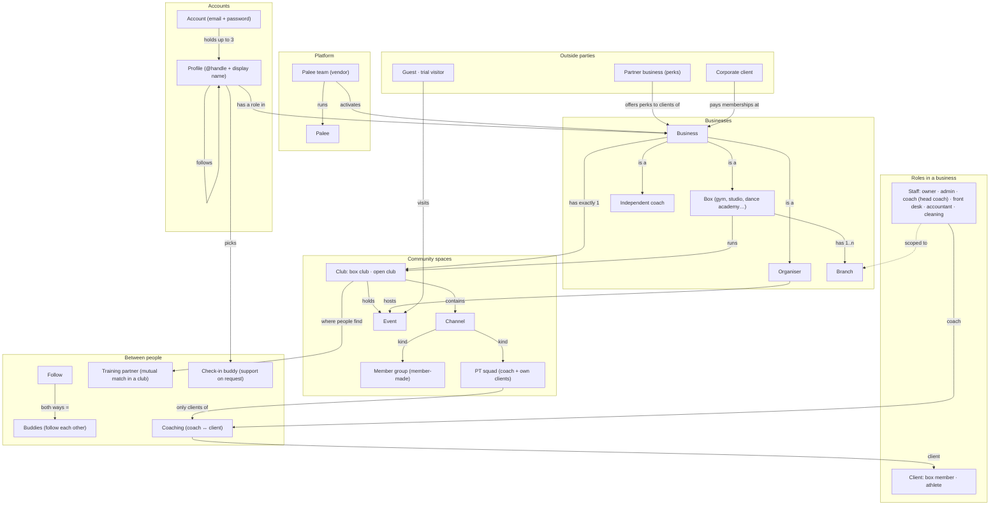
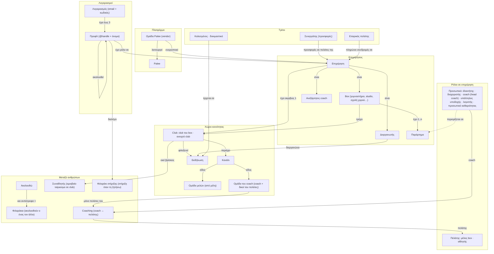

# Palee ontology: canonical terms (English · Ελληνικά)

Status: **draft, 2026-10-25**, waiting for ANR's choices in §5. Once approved it is the
source of truth for every name in the UI, the docs and code comments; the code keeps its
table and module names (column «Code»), which never appear in the UI.

How to use it:
- One thing, one name, in each language. If a screen needs a name that is not here, add it
  here first.
- «Not to be confused with» lists the near names that caused confusion so far.
- Greek uses the English loanword only where Greek users already say it (Box, club, coach, PR, WOD).
  Abbreviations that Greeks don't use (PT) and words they don't know (squad) are written in Greek.
- A person's role is always a word for the person, never the department (λογιστής, not «Λογιστήριο»).
- Never write a bare "member" / «μέλος»: always say what of (box member, club member).

## 1. The layers at a glance

1. **Platform**: Palee and the Palee team.
2. **Accounts and profiles**: who signs in, and who they appear as.
3. **Businesses**: the providers people train with (box, independent coach) and event organisers.
4. **Inside a business**: branches, roles, staff, clients, plans.
5. **Community spaces**: clubs and the channels inside them.
6. **Person-to-person relations**: follows, buddies, training partners, check-in buddies, coaching.
7. **Conversations**: everything in Μηνύματα.
8. **Outside parties**: partner businesses (perks), corporate clients, guests.

## 2. Graph (English)

## 3. Γράφος (Ελληνικά)

## 4. Glossary

Terms marked **(proposed)** change today's wording; see §5. Everything else matches the app.

### 4.1 Platform and accounts

| English | Ελληνικά | Code | What it is | Not to be confused with |
|---|---|---|---|---|
| Palee | Palee | `Palee` | The app and the company behind it. | Hosted at palee.app; the infrastructure was renamed too (TD-109). |
| Palee team | Ομάδα Palee | `vendor` role, `/platform` | The people who run Palee: activate businesses, set plans, handle password resets. Shown as "Palee" to users. (ADR-089) | Business owner. "Vendor" is a code word only. |
| Account | Λογαριασμός | `logins` | One email and one password. Holds up to 3 profiles. (ADR-187) | Profile. |
| Profile | Προφίλ | `users` | Who you appear as: unique Latin **@handle** plus a free **display name**. Everything social and every role hangs on a profile. | Account. |
| Mock person | Εικονικό άτομο | `users.demo_organization_id` | A fake member created for a business in demo mode. Never visible outside it. (ADR-184) | Trial visitor, guest. |

### 4.2 Businesses

| English | Ελληνικά | Code | What it is | Not to be confused with |
|---|---|---|---|---|
| Business | Επιχείρηση | `organizations` (tenant) | Umbrella for anyone who runs things on Palee. Each has one kind below, a slug, a club and a plan. Demo until the Palee team activates it. | "Organization", "provider", "tenant" are code words. |
| Box | Box | `provider_kind: gym` | A place people train at: gym, CrossFit box, studio, **dance academy**, martial-arts school. What it offers is described by discipline tags, not by a separate kind. | Club (the box's community space). **(proposed)**: one word, "Box", replaces "Gym" / «Γυμναστήριο» in member screens. |
| Independent coach | Ανεξάρτητος coach | `provider_kind: coach` | A coach with their own clients and no box (the solo-coach tier, ADR-170). Same person can also be staff at a box. | **(proposed)** replaces "Personal coach", "Solo coach", «Προσωπικός coach», «Ανεξάρτητος προπονητής». |
| Organiser | Διοργανωτής | `provider_kind: organiser` | The hidden one-person business created when someone hosts an event «Ως εγώ». (ADR-185) | Co-host. |
| Co-host | Συνδιοργανωτής | `event_cohosts` | Another business that agrees to co-run an event. | Organiser. |
| Branch | Παράρτημα | `facility_locations` | One physical location of a box. Staff can be limited to some branches. (ADR-186) | **(proposed)** replaces «Κατάστημα», which also means the e-shop. |
| Branch manager | Υπεύθυνος παραρτήματος | role preset | Admin rights limited to chosen branches. | Owner. |
| Space | Χώρος | `spaces` | A room or area of a branch (or of the whole box): where classes take place, what the cleaning staff clean, where the equipment stands. Can be made unavailable for a time. (ADR-202) | Branch («Παράρτημα», never «Χώρος»); Club and community spaces (§4.4). Was "cleaning area". |
| Floor plan | Κάτοψη | `space_floor_plans` | An image of one floor of a branch, with the spaces drawn on it. A branch can have several. (ADR-202) | Map (Around). |
| Plan (Palee) | Πακέτο Palee | `platform_plans` | What a business pays Palee. | Membership plan, package (what clients pay the business). |

### 4.3 Roles inside a business

| English | Ελληνικά | Code | What it is |
|---|---|---|---|
| Staff | Προσωπικό | staff roles | Anyone with one of the roles below. Opens the console by default; «Διαχείριση» switches back from the social app. |
| Owner | Ιδιοκτήτης | `owner` | Everything, always all branches. |
| Admin | Διαχειριστής | `admin` | Runs the business; can be branch-scoped. |
| Coach | Coach | `coach` | Leads classes, coaches own clients. |
| Head coach | Head coach | `coach_scope: all` | A coach who sees and coaches every client, not only their own. |
| Front desk | Υπάλληλος υποδοχής | `front_desk` | Check-in, bookings, selling packages at the desk. (ADR-102) |
| Accountant | Λογιστής | `accountant` | Money only. |
| Cleaning staff | Προσωπικό καθαριότητας | `janitor` | The cleaning log only. |
| Client | Πελάτης | member or athlete role | Someone who trains with the business. Umbrella word for the two below. |
| Box member | Μέλος box | `member` | Client of a box with a membership or package. Where the box is known, name it: "Member of Box Kypseli" / «Μέλος στο Box Kypseli». Never a bare "Member" / «Μέλος». |
| Athlete | Αθλητής | `athlete` | Client who gets **personal programming** from a coach. |
| Personal link | Προσωπικός σύνδεσμος | `registration_invitations` | One-time invitation for one person, any role including staff. |
| Join links | Σύνδεσμοι εγγραφής | `organization_settings.join_link` | Public links, one per client role, each on or off on its own: «Σύνδεσμος για μέλη box» (`/join/<slug>`) and «Σύνδεσμος για αθλητές» (`/join/<slug>/athlete/<key>`). The link sets the role, never the visitor. (ADR-216) |

### 4.4 Community spaces

| English | Ελληνικά | Code | What it is | Not to be confused with |
|---|---|---|---|---|
| Club | Club | `community_clubs` | A space with club members («μέλη club»), a feed, channels and events. Shown as a bubble in the club bar. | Box (the business). |
| Box club | Club του box | `kind: gym` | Every business has exactly one. Its members are the box's active clients; its staff are the box's staff. Named after the box. | |
| Open club | Ανοιχτό club | `kind: open` | A club staff create for a theme (e.g. Saturday trail runs). Anyone who belongs to or follows the box can join or ask to join. | Group. |
| Channel | Κανάλι | `community_channels` | A stream of posts inside a club: #ανακοινώσεις, #wod-σήμερα, #challenges, a class's channel, a season's channel. | Conversation (Μηνύματα). |
| Member group | Ομάδα μελών | `channel kind: member_group` | A channel members propose inside their box's club; has its own admins. | Open club (staff-made, its own bubble). |
| PT squad | Ομάδα του coach | `channel kind: pt_squad` | A coach's private channel with up to 30 of their own clients. Greek formerly «PT squad». (ADR-168) | Member group, class. |
| Class channel | Κανάλι μαθήματος | `channel kind: class_slot` | The channel of one class on the schedule. Formerly «ομάδα τάξης». | Member group. |
| Personal training | Προσωπική προπόνηση | `pt_pack`, appointments | One-to-one sessions with a coach, sold as personal training packages («Πακέτο προσωπικών προπονήσεων»). "PT" is never written in Greek. | Class. |
| Online programming | Online προγραμματισμός | `online_coaching` (package module) | A package service where a coach sends personal training plans and, optionally, messages, check-ins, technique video reviews and a nutrition plan, all remotely. Formerly "Online coaching" / «Online καθοδήγηση»; the code key stays `online_coaching` because saved packages store it. | Personal training (in person), Coaching (the coach ↔ client relation). |
| Event | Εκδήλωση | `community_events` | A one-off or weekly happening with places, price and attendees. Run by a club or an organiser. | Class (on the schedule). |
| Class | Μάθημα | `class_slots` | A scheduled session on the box's timetable, booked with a package. | Event. |

### 4.5 Relations between people

| English | Ελληνικά | Code | What it is | Not to be confused with |
|---|---|---|---|---|
| Follow / follower | Ακολουθώ / ακόλουθος | `community_follows` | One-way. Instant for public profiles (the default), a request for private ones. | |
| Buddies | Φιλαράκια | derived: mutual follows | Two people who follow each other. Can message each other anywhere. (ADR-193) | Check-in buddy. |
| Training partner | Συναθλητής **(proposed)** | `partners` context | A match between two members of the same club who both said yes, to train together («Κλείστε μαζί»). Opt-in per club. (ADR-169) | Partner business. Today the Greek UI says "Partners". |
| Check-in buddy | Φιλαράκι στήριξης | `buddy_links` | One or two people you pick to hear from you when you ask for support (cravings, motivation); can get your weekly summary. (ADR-160) | Buddies (mutual follow). |
| Coaching | Coaching | `coaching_relationships` | A coach and a client at one business. Decides what the coach sees and who can join their PT squad. | Follow. |
| My clients | Οι πελάτες μου | coach view | The coach's list of active coaching clients (Box › Πελάτες μου). | Members of the box. |
| PR sharing | Κοινοποίηση PR | `pr_sharing_grants` | A person lets a specific person see all their PRs. | Follow. |

### 4.6 Conversations (Μηνύματα)

| English | Ελληνικά | Code | What it is |
|---|---|---|---|
| Conversation | Συνομιλία | `person_conversations` | Two people, anywhere on Palee. |
| Message request | Αίτημα μηνύματος | `folder: requests` | A first message from someone you have no relation with. |
| Group chat | Ομαδική συνομιλία **(proposed name)** | `messaging_threads` box/class | The box's thread and each class's thread. Today they sit under the «Clubs» tab. There is no user-made group chat yet. |
| Coach chat | Συνομιλία με coach | thread with a coach / assignment | Chats about your training with your coach; the «Coach» tab. |
| Training partner chat | Συνομιλία συναθλητών | partner match thread | Opens when a training-partner match happens. |
| Check-in buddy chat | Συνομιλία στήριξης | buddy support thread | Opens when a check-in buddy answers a support request. |

### 4.6a Class booking rules (ADR-226)

| English | Ελληνικά | Code | What it is | Not to be confused with |
|---|---|---|---|---|
| Time to answer a booking request | Χρόνος για απάντηση σε αίτηση κράτησης | `booking_timeout_minutes` | Without automatic confirmation, how long a request waits for staff before it is cancelled; «Χωρίς όριο» = until the class starts. | Bookings open; a booking deadline. |
| Bookings open | Άνοιγμα κρατήσεων | `booking_window_days` | The earliest a member can book, in days before the class. Bookings stay open until the start. | Time to answer a request. |
| Late cancellation | Καθυστερημένη ακύρωση | `default_cancellation_cutoff_minutes` | Cancelling later than this before the class still uses the visit. Entered as hours + minutes. | Cancelling a class (staff). |
| Automatic confirmation | Αυτόματη επιβεβαίωση κρατήσεων | `auto_approve` | A booking is confirmed at once instead of waiting for staff. | Booking request. |

### 4.7 Outside parties

| English | Ελληνικά | Code | What it is | Not to be confused with |
|---|---|---|---|---|
| Partner business | Συνεργάτης | `perks.partner_name` | An outside shop or service that gives the box's clients a perk. Has no Palee account. (ADR-191) | Training partner. |
| Perk | Προσφορά συνεργάτη | `perks` | A discount or gift from a partner business, claimed in Πληρωμές › Προσφορές. | Promotion (the box's own discount). |
| Corporate client | Εταιρικός πελάτης | `finance_corporate_clients` | A company that pays memberships for its employees. | Client (a person). |
| Guest | Καλεσμένος | event `source: guest` | Someone a member brings to an event. | Trial visitor. |
| Trial visitor | Δοκιμαστικό | `trials` | A newcomer trying one class. | Guest, mock person. |
| Referral | Φέρε φίλο | `referrals` | A member invites a friend; rewards on trial or join. | Guest. |

## 5. Name clashes found, and proposals

Each needs ANR's choice before the UI changes. The recommended option is first.

1. **"Partners" means three different things.**
   - Training partners (member ↔ member match), partner businesses (perks), and the Μηνύματα tab
     that holds both training-partner and check-in-buddy chats.
   - **Proposal:** training partner → EN "Training partner", EL «Συναθλητής»; partner business stays
     "Partner" / «Συνεργάτης» and appears only in perks screens; the inbox tab becomes
     "Training partners" / «Συναθλητές», and check-in buddy chats move to the «Άτομα» tab.
2. **"Buddies" and "Check-in buddy" sound like the same thing.**
   - **Proposal A (lighter):** keep both, but never write a bare "buddy" for the check-in kind; always the
     full name.
   - **Proposal B:** rename check-in buddy → "Support person" / «Άτομο στήριξης».
3. **The coach business has five names** (Personal coach, Independent coach, Solo coach,
   «Προσωπικός coach», «Ανεξάρτητος προπονητής»).
   - **Proposal:** "Independent coach" / «Ανεξάρτητος coach» everywhere.
4. **Box, gym and «Γυμναστήριο» are used for the same business.**
   - **Proposal:** "Box" in every member-facing screen, whatever the discipline (dance academies
     included); "Gym or box" only on the sign-up choice, where people pick their kind.
5. **Branch is «Κατάστημα» in staff screens and «Παράρτημα» in the shop**, and «Κατάστημα» is also
   the e-shop.
   - **Proposal:** Branch = «Παράρτημα»; Shop = «Κατάστημα».
6. **Coach vs «προπονητής» in Greek.**
   - **Proposal:** «coach» everywhere (the app already says Box › Coach, head coach).
7. **Followers in Greek** appear as «followers», «Όσοι με ακολουθούν» and «Ακολουθείς».
   - **Proposal:** noun «ακόλουθοι», verb «ακολουθώ».
8. **«Clubs» tab in Μηνύματα** lists the box's and classes' group chats, not clubs.
   - **Proposal:** rename the tab to "Box" / «Box», and call those threads "group chats".
9. **Athlete** is a role (gets personal programming), but every user trains, and box tags also say
   "Competitive athletes".
   - **Proposal:** keep the role, but show it as "Athlete (personal programming)" /
     «Αθλητής (προσωπικό πρόγραμμα)» wherever roles are picked.

## 6. Rules for new terms

- Add the term to §4 in both languages before it reaches a screen.
- Prefer a word the app already uses over a synonym; never reuse a word for a second thing.
- Code names stay English and may differ from UI names; the «Code» column links them.
