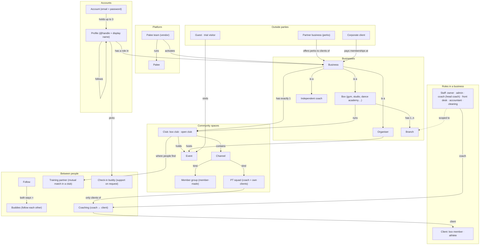
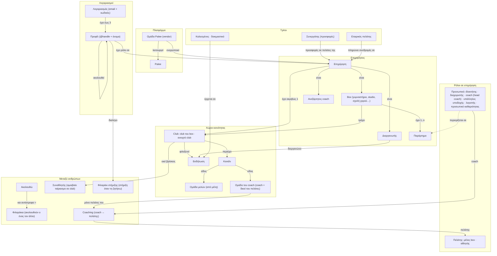

# Palee ontology: canonical terms (English · Ελληνικά)

Status: **draft, 2026-10-25**, waiting for ANR's choices in §5. Once approved it is the
source of truth for every name in the UI, the docs and code comments; the code keeps its
table and module names (column «Code»), which never appear in the UI.

How to use it:
- One thing, one name, in each language. If a screen needs a name that is not here, add it
  here first.
- «Not to be confused with» lists the near names that caused confusion so far.
- Greek uses the English loanword only where Greek users already say it (Box, club, coach, PR, WOD).
  Abbreviations that Greeks don't use (PT) and words they don't know (squad) are written in Greek.
- A person's role is always a word for the person, never the department (λογιστής, not «Λογιστήριο»).
- Never write a bare "member" / «μέλος»: always say what of (box member, club member).

## 1. The layers at a glance

1. **Platform**: Palee and the Palee team.
2. **Accounts and profiles**: who signs in, and who they appear as.
3. **Businesses**: the providers people train with (box, independent coach) and event organisers.
4. **Inside a business**: branches, roles, staff, clients, plans.
5. **Community spaces**: clubs and the channels inside them.
6. **Person-to-person relations**: follows, buddies, training partners, check-in buddies, coaching.
7. **Conversations**: everything in Μηνύματα.
8. **Outside parties**: partner businesses (perks), corporate clients, guests.

## 2. Graph (English)

## 3. Γράφος (Ελληνικά)

## 4. Glossary

Terms marked **(proposed)** change today's wording; see §5. Everything else matches the app.

### 4.1 Platform and accounts

| English | Ελληνικά | Code | What it is | Not to be confused with |
|---|---|---|---|---|
| Palee | Palee | `Palee` | The app and the company behind it. | Hosted at palee.app; the infrastructure was renamed too (TD-109). |
| Palee team | Ομάδα Palee | `vendor` role, `/platform` | The people who run Palee: activate businesses, set plans, handle password resets. Shown as "Palee" to users. (ADR-089) | Business owner. "Vendor" is a code word only. |
| Account | Λογαριασμός | `logins` | One email and one password. Holds up to 3 profiles. (ADR-187) | Profile. |
| Profile | Προφίλ | `users` | Who you appear as: unique Latin **@handle** plus a free **display name**. Everything social and every role hangs on a profile. | Account. |
| Mock person | Εικονικό άτομο | `users.demo_organization_id` | A fake member created for a business in demo mode. Never visible outside it. (ADR-184) | Trial visitor, guest. |

### 4.2 Businesses

| English | Ελληνικά | Code | What it is | Not to be confused with |
|---|---|---|---|---|
| Business | Επιχείρηση | `organizations` (tenant) | Umbrella for anyone who runs things on Palee. Each has one kind below, a slug, a club and a plan. Demo until the Palee team activates it. | "Organization", "provider", "tenant" are code words. |
| Box | Box | `provider_kind: gym` | A place people train at: gym, CrossFit box, studio, **dance academy**, martial-arts school. What it offers is described by discipline tags, not by a separate kind. | Club (the box's community space). **(proposed)**: one word, "Box", replaces "Gym" / «Γυμναστήριο» in member screens. |
| Independent coach | Ανεξάρτητος coach | `provider_kind: coach` | A coach with their own clients and no box (the solo-coach tier, ADR-170). Same person can also be staff at a box. | **(proposed)** replaces "Personal coach", "Solo coach", «Προσωπικός coach», «Ανεξάρτητος προπονητής». |
| Organiser | Διοργανωτής | `provider_kind: organiser` | The hidden one-person business created when someone hosts an event «Ως εγώ». (ADR-185) | Co-host. |
| Co-host | Συνδιοργανωτής | `event_cohosts` | Another business that agrees to co-run an event. | Organiser. |
| Branch | Παράρτημα | `facility_locations` | One physical location of a box. Staff can be limited to some branches. (ADR-186) | **(proposed)** replaces «Κατάστημα», which also means the e-shop. |
| Branch manager | Υπεύθυνος παραρτήματος | role preset | Admin rights limited to chosen branches. | Owner. |
| Space | Χώρος | `spaces` | A room or area of a branch (or of the whole box): where classes take place, what the cleaning staff clean, where the equipment stands. Can be made unavailable for a time. (ADR-202) | Branch («Παράρτημα», never «Χώρος»); Club and community spaces (§4.4). Was "cleaning area". |
| Floor plan | Κάτοψη | `space_floor_plans` | An image of one floor of a branch, with the spaces drawn on it. A branch can have several. (ADR-202) | Map (Around). |
| Plan (Palee) | Πακέτο Palee | `platform_plans` | What a business pays Palee. | Subscription package (what clients pay the business). |
| Subscription package | Πακέτο συνδρομής | `membership_packages`, `package_type` | What a client buys or is given by a box: recurring membership, visit pack, trial, season, corporate. Always the full name, never a bare "package" / «πακέτο». Trial type: "Trial" / «Δοκιμαστικό» (never «Δίκη»). | Plan (Palee), personal training package. |

### 4.3 Roles inside a business

| English | Ελληνικά | Code | What it is |
|---|---|---|---|
| Staff | Προσωπικό | staff roles | Anyone with one of the roles below. Opens the console by default; «Διαχείριση» switches back from the social app. |
| Owner | Ιδιοκτήτης | `owner` | Everything, always all branches. |
| Admin | Διαχειριστής | `admin` | Runs the business; can be branch-scoped. |
| Coach | Coach | `coach` | Leads classes, coaches own clients. |
| Head coach | Head coach | `coach_scope: all` | A coach who sees and coaches every client, not only their own. |
| Front desk | Υπάλληλος υποδοχής | `front_desk` | Check-in, bookings, selling packages at the desk. (ADR-102) |
| Accountant | Λογιστής | `accountant` | Money only. |
| Cleaning staff | Προσωπικό καθαριότητας | `janitor` | The cleaning log only. |
| Client | Πελάτης | member or athlete role | Someone who trains with the business. Umbrella word for the two below. |
| Box member | Μέλος box | `member` | Client of a box with a membership or package. Where the box is known, name it: "Member of Box Kypseli" / «Μέλος στο Box Kypseli». Never a bare "Member" / «Μέλος». |
| Athlete | Αθλητής | `athlete` | Client who gets **personal programming** from a coach. |
| Guest | Επισκέπτης | `guest` | Someone with a Palee account whom staff made a guest of the box at the desk, so they can buy a membership package, a free sale or a shop order there. The lowest client tier; one person can be a guest of many boxes. Sees no member app of the box, only the public box page with «Γίνε μέλος box». Never self-chosen. (ADR-272) |
| Personal link | Προσωπικός σύνδεσμος | `registration_invitations` | One-time invitation for one person, any role including staff. |
| Join links | Σύνδεσμοι εγγραφής | `organization_settings.join_link` | Public links, one per client role, each on or off on its own: «Σύνδεσμος για μέλη box» (`/join/<slug>`) and «Σύνδεσμος για αθλητές» (`/join/<slug>/athlete/<key>`). The link sets the role, never the visitor. (ADR-216) |

### 4.4 Community spaces

| English | Ελληνικά | Code | What it is | Not to be confused with |
|---|---|---|---|---|
| Club | Club | `community_clubs` | A space with club members («μέλη club»), a feed, channels and events. Shown as a bubble in the club bar. | Box (the business). |
| Box club | Club του box | `kind: gym` | Every business has exactly one. Its members are the box's active clients; its staff are the box's staff. Named after the box. | |
| Open club | Ανοιχτό club | `kind: open` | A club staff create for a theme (e.g. Saturday trail runs). Anyone who belongs to or follows the box can join or ask to join. | Group. |
| Channel | Κανάλι | `community_channels` | A stream of posts inside a club: #ανακοινώσεις, #wod-σήμερα, #challenges, a class's channel, a season's channel. | Conversation (Μηνύματα). |
| Member group | Ομάδα μελών | `channel kind: member_group` | A channel members propose inside their box's club; has its own admins. | Open club (staff-made, its own bubble). |
| PT squad | Ομάδα του coach | `channel kind: pt_squad` | A coach's private channel with up to 30 of their own clients. Greek formerly «PT squad». (ADR-168) | Member group, class. |
| Class channel | Κανάλι τμήματος | `channel kind: class_slot` | The channel of one class on the schedule. Formerly «ομάδα τάξης», «Κανάλι μαθήματος». | Member group. |
| Personal training | Προσωπική προπόνηση | `pt_pack`, appointments | One-to-one sessions with a coach, sold as personal training packages («Πακέτο προσωπικών προπονήσεων»). "PT" is never written in Greek. | Class. |
| Online programming | Online προγραμματισμός | `online_coaching` (package module) | A package service where a coach sends personal training plans and, optionally, messages, check-ins, technique video reviews and a nutrition plan, all remotely. Formerly "Online coaching" / «Online καθοδήγηση»; the code key stays `online_coaching` because saved packages store it. | Personal training (in person), Coaching (the coach ↔ client relation). |
| Event | Εκδήλωση | `community_events` | A one-off or weekly happening with places, price and attendees. Run by a club or an organiser. | Class (on the schedule). |
| Class | Τμήμα | `class_slots` | A scheduled session on the box's timetable, booked with a subscription package. The code's "slot" is never shown: a class is never «slot», «θέση», «τάξη», «κλάση» or «κουλοχέρης». | Event, class type (Τύπος τμήματος). |
| Recurring class | Επαναλαμβανόμενο τμήμα | `class_series` | A class that repeats on a pattern (formerly "series"). The form's start time is "Class start time" / «Ώρα έναρξης τμήματος». | Season. |
| Trial class | Δοκιμαστικό τμήμα | `trials` | A newcomer's free class. Short form «Δοκιμαστικό». A trial period of a plan is «Δοκιμαστική περίοδος». | Guest. |
| Day WOD | WOD ημέρας | `day_workouts` | The WOD set for a whole date: every class (τμήμα) of that day, or only chosen class types (and, with branches, one branch), takes it unless the class has its own WOD. (ADR-230) | A class's own WOD (an override); «WOD σήμερα» (the club channel). |
| Workout type | Τύπος προπόνησης | `master_workouts.type`, `WorkoutType` | The kind of training a WOD is (CrossFit, Πυγμαχία, Χορός …): one fixed list for the platform, grouped in families (Λειτουργική & CrossFit, Δύναμη, Γυμναστική & σωματικό βάρος, Αντοχή, Σώμα & νους, Μαχητικά αθλήματα, Χορός, Υπαίθριο, Αποκατάσταση) that stats, badges and colours read. The box chooses which ones its editors offer (Ρυθμίσεις › Τύποι προπόνησης). (ADR-275) | Class type (Τύπος τμήματος): the box's own list for its timetable, bookings and credits. |

### 4.5 Relations between people

| English | Ελληνικά | Code | What it is | Not to be confused with |
|---|---|---|---|---|
| Follow / follower | Ακολουθώ / ακόλουθος | `community_follows` | One-way. Instant for public profiles (the default), a request for private ones. | |
| Buddies | Φιλαράκια | derived: mutual follows | Two people who follow each other. Can message each other anywhere. (ADR-193) | Check-in buddy. |
| Training partner | Συναθλητής **(proposed)** | `partners` context | A match between two members of the same club who both said yes, to train together («Κλείστε μαζί»). Opt-in per club. (ADR-169) | Partner business. Today the Greek UI says "Partners". |
| Check-in buddy | Φιλαράκι στήριξης | `buddy_links` | One or two people you pick to hear from you when you ask for support (cravings, motivation); can get your weekly summary. (ADR-160) | Buddies (mutual follow). |
| Coaching | Coaching | `coaching_relationships` | A coach and a client at one business. Decides what the coach sees and who can join their PT squad. | Follow. |
| My clients | Οι πελάτες μου | coach view | The coach's list of active coaching clients (Box › Πελάτες μου). | Members of the box. |
| PR sharing | Κοινοποίηση PR | `pr_sharing_grants` | A person lets a specific person see all their PRs. | Follow. |
| Media (profile tab) | Πολυμέσα | `GET /api/people/:id/media` | The profile tab with a person's photos and videos: a grid of their profile posts that carry media, under the same audience as the posts. There are no separate «reels»: a video is a post with a video. (ADR-231) | Αναρτήσεις (every post, text included). |

### 4.6 Conversations (Μηνύματα)

| English | Ελληνικά | Code | What it is |
|---|---|---|---|
| Conversation | Συνομιλία | `person_conversations` | Two people, anywhere on Palee. |
| Message request | Αίτημα μηνύματος | `folder: requests` | A first message from someone you have no relation with. |
| Group chat | Ομαδική συνομιλία **(proposed name)** | `messaging_threads` box/class | The box's thread and each class's thread. Today they sit under the «Clubs» tab. There is no user-made group chat yet. |
| Coach chat | Συνομιλία με coach | thread with a coach / assignment | Chats about your training with your coach; the «Coach» tab. |
| Training partner chat | Συνομιλία συναθλητών | partner match thread | Opens when a training-partner match happens. |
| Check-in buddy chat | Συνομιλία στήριξης | buddy support thread | Opens when a check-in buddy answers a support request. |
| Box conversation | Συνομιλία με το box | `messaging_threads` context `box` (ADR-282) | Anyone with an account and one box. The person writes on `/b/:slug/chat`; the box answers as itself. «Επικοινωνία με το box» opens it. |
| The box's inbox | Εισερχόμενα του box | capability `message_from_box` | Everyone who answers for the box (owner, admin, front desk, accountant), in Μηνύματα › Box. Filters «Αναπάντητα» and «Όλα». |
| Newcomer | Νέος | `box_person.newcomer` | Someone writing to a box who is not, and was never, its client. Waits for an answer after three messages; may be blocked («Αποκλεισμός»). |
| Bring in a coach | Φέρε τον coach | `joined_as: coach` | The inbox adds a coach of the box to one conversation; the topic «Προπόνηση» adds the person's coaches by itself. |
| Topic | Θέμα | `messaging_messages.topic` | Κράτηση, Πληρωμή, Συνδρομή, Προπόνηση, Χώρος. |

### 4.6a Class booking rules (ADR-226)

| English | Ελληνικά | Code | What it is | Not to be confused with |
|---|---|---|---|---|
| Time to answer a booking request | Χρόνος για απάντηση σε αίτηση κράτησης | `booking_timeout_minutes` | Without automatic confirmation, how long a request waits for staff before it is cancelled; «Χωρίς όριο» = until the class starts. | Bookings open; a booking deadline. |
| Bookings open | Άνοιγμα κρατήσεων | `booking_window_days` | The earliest a member can book, in days before the class. Bookings stay open until the start. | Time to answer a request. |
| Late cancellation | Καθυστερημένη ακύρωση | `default_cancellation_cutoff_minutes` | Cancelling later than this before the class still uses the visit. Entered as hours + minutes. | Cancelling a class (staff). |
| Automatic confirmation | Αυτόματη επιβεβαίωση κρατήσεων | `auto_approve` | A booking is confirmed at once instead of waiting for staff. | Booking request. |

### 4.7 Outside parties

| English | Ελληνικά | Code | What it is | Not to be confused with |
|---|---|---|---|---|
| Partner business | Συνεργάτης | `perks.partner_name` | An outside shop or service that gives the box's clients a perk. Has no Palee account. (ADR-191) | Training partner. |
| Perk | Προσφορά συνεργάτη | `perks` | A discount or gift from a partner business, claimed in Πληρωμές › Προσφορές. | Promotion (the box's own discount). |
| Corporate client | Εταιρικός πελάτης | `finance_corporate_clients` | A company that pays memberships for its employees. | Client (a person). |
| Guest | Καλεσμένος | event `source: guest` | Someone a member brings to an event. | Trial visitor. |
| Trial visitor | Δοκιμαστικό | `trials` | A newcomer trying one class. | Guest, mock person. |
| Referral | Φέρε φίλο | `referrals` | A member invites a friend; rewards on trial or join. | Guest. |

### 4.8 Terms in other languages

"Coaching", "coach", box, WOD, PR, RX, scale, AMRAP, EMOM, For Time, Tabata and check-in stay untranslated where
gyms use them. Address is always informal singular (du, tu, tú, ты, εσύ). `apps/web/src/i18n/ontology-wording.test.ts`
fails on the banned words.

| Locale | Class | Recurring class | Class start time | Subscription package | Banned for a class |
|---|---|---|---|---|---|
| en | class | recurring class | Class start time | subscription package | slot, series |
| el | τμήμα | επαναλαμβανόμενο τμήμα | Ώρα έναρξης τμήματος | πακέτο συνδρομής | τάξη, κλάση, κουλοχέρης, δίκη (trial) |
| de | Kurs | wiederkehrender Kurs | Kursbeginn | Abo-Paket | Klasse, Slot, Steckplatz, Spielautomat |
| fr | cours | cours récurrent | Heure de début du cours | forfait d'abonnement | classe, emplacement, machine à sous |
| es | clase | clase recurrente | Hora de inicio de la clase | paquete de suscripción | ranura, tragaperras |
| it | lezione | lezione ricorrente | Ora di inizio della lezione | pacchetto di abbonamento | classe, slot |
| ru | занятие | повторяющееся занятие | Время начала занятия | абонементный пакет | класс, урок, слот |
| pt-PT | aula | aula recorrente | Hora de início da aula | pacote de subscrição | turma, classe, slot, ranhura |
| nl | les | terugkerende les | Begintijd van de les | abonnementspakket | klas, slot, sleuf, gokkast |
| bg | занятие | повтарящо се занятие | Начален час на занятието | абонаментен пакет | клас, слот, ротативка |
| ar | حصة | حصة متكررة | وقت بدء الحصة | باقة اشتراك | فصل، صف، فتحة، آلة القمار |
| he | שיעור | שיעור קבוע | שעת תחילת השיעור | חבילת מנוי | כיתה, משבצת, מכונת מזל |

pt-PT, nl, bg, ar and he got only these terms and the class fixes; their full rewrite is TD-206.

**Timer phases (ANR 2026-10-30).** The work phase of an interval is the word gyms use on their own timers, never
a job («δουλειά») or a switch ("on/off"). One word per locale for the phase label, the plan parameter, the editor
timeline and every "work time" compound; HR is heart rate («παλμοί», FC, Puls), never human resources.

| Locale | Work (phase) | Rest (phase) |
|---|---|---|
| en | Work | Rest |
| el | Άσκηση | Ξεκούραση |
| de | Belastung | Pause |
| fr | Effort | Repos |
| es | Trabajo | Descanso |
| it | Lavoro | Recupero |
| ru | Работа | Отдых |
| pt-PT | Trabalho | Descanso |
| nl | Inspanning | Rust |
| bg | Работа | Почивка |
| ar | تمرين | راحة |
| he | עבודה | מנוחה |

### 4.9 Goals and streaks

| English | Ελληνικά | Code | What it is | Not to be confused with |
|---|---|---|---|---|
| Weekly goal | Εβδομαδιαίος στόχος | `training_goals` kind `weekly_workouts` | How many workouts make a person's week count. Theirs to set; their coach (or staff who coach every client) may set it, and the person is told. (ADR-229) | WOD goals (the muscles and qualities a workout trains). |
| Streak | Σερί | `user_stats.current_streak` | Days or weeks in a row of training. One streak only (ADR-194). | |
| Streak shield | Ασπίδα σερί | `gamification_settings.streak_shields` | Saves a streak in a week that missed the weekly goal. The box sets how many each client gets (0–5) and when they renew. (ADR-229) | |
| Shield renewal | Ανανέωση ασπίδων | `streak_shield_reset_day` | When shields are topped up: a day of the month for everyone, or each client's sign-up day. | |

### 4.10 Box screen (ADR-253)

| English | Ελληνικά | Code | What it is | Not to be confused with |
|---|---|---|---|---|
| Box screen | Οθόνη box | `box_screens` | A TV on the box's wall (one branch or the whole box) that shows today's classes, WODs, bookings, leaderboards and the class timer. People appear by first name only. | Wall display of one class timer; the console. |
| Pairing code | Κωδικός σύνδεσης | `pairing_code` | The 8-character code (`ABCD-EFGH`) staff get for a box screen and type on the TV; works once, for 15 minutes. A new code moves the screen to another TV. | Join links; the member's check-in code. |
| Automatic | Αυτόματο | `focus.source: auto` | The box screen follows the day: next class, its timer while it runs, its results for 30 minutes after. «Επιστροφή στο αυτόματο» ends a staff choice. | Pinned (`focus.source: staff`, «Καρφιτσωμένο»): what staff chose to show. |
| On screen | Στην οθόνη | `/class-timers/:slot_id/screens` | The coach's action on their class's timer remote: pin the class's timer («Χρονόμετρο»), leaderboard or WOD on a box screen of the class's branch or the whole box, today only, and «Επιστροφή στο αυτόματο». Only the class's own coach (and staff who manage screens). | Staff › Settings › «Οθόνες box» (staff only). |

### 4.11 Documents and signatures (ADR-252)

| English | Ελληνικά | Code | What it is | Not to be confused with |
|---|---|---|---|---|
| Documents | Έγγραφα | `document_templates` | The box's texts that clients read and sign: waiver, terms, privacy notice, health declaration, other. | Fiscal documents (receipts, invoices: «Παραστατικά»). |
| Mandatory | Υποχρεωτικό | `requirement: mandatory` | A document every client must sign; unsigned, it counts as outstanding and (by default) blocks booking. | Optional. |
| Optional | Προαιρετικό | `requirement: optional` | A document offered to clients; it never blocks anything. | Mandatory. |
| Version | Έκδοση | `document_versions` | The fixed text of a document as published. A **major change** («Ουσιαστική αλλαγή») asks everyone to sign again; a **minor change** («Μικρή διόρθωση») does not. | Draft. |
| Signature | Υπογραφή | `document_signatures` | A client's simple electronic signature of one version: typed name and/or drawn signature, with its evidence. | Check-in, consent toggles. |
| Signature request | Αίτημα υπογραφής | `document_signature_requests` | Staff asking one client, or in bulk all clients, a role or a package's holders, to sign. | Booking request. |
| Signature certificate | Πιστοποιητικό υπογραφής | `evidence_object_key` | The PDF with the signed text and the evidence (hashes, time, IP, device, account). | Health certificate. |
| Signs again | Νέα υπογραφή | status `resign_required` | A major version was published after the client signed. | Unsigned. |
| Health certificate | Βεβαίωση υγείας | `health_certificates` | A doctor's certificate that the client may train, valid 1 year by default. Palee keeps only its dates and file. | Health declaration (a text the client signs). |
| Health declaration | Υπεύθυνη δήλωση υγείας | kind `health_certificate` | A starter document the client signs about their own health. | Health certificate. |
| Draft for legal review | Προσχέδιο για νομικό έλεγχο | `legal_review_required` | Palee's starter texts: a lawyer must review them before a box publishes them. | Version. |

### 4.12 Setup and settings (ADR-255)

| English | Ελληνικά | Code | What it is | Not to be confused with |
|---|---|---|---|---|
| Setup recipe | Συνταγή στησίματος | `Palee.Setup`, `recipe_key` | A ready set of starting choices for one kind of box (packages, class types, booking rules, settings), applied in one step and changeable later. | Template (a document template, V3-M8); plan (Palee). |
| Preview of changes | Προεπισκόπηση αλλαγών | `preview`, `RecipePlan` | What a setup recipe would change now, before anything is saved. | |
| Advanced settings | Προχωρημένα | `advanced: true` | Settings whose default suits most boxes; closed by default under each settings area. | «Περισσότερα» (no "More" drawer, vision §4.8). |
| CrossFit box · Functional / HYROX · Personal training studio · Yoga / Pilates studio · Martial arts school · Open gym · Independent coach | CrossFit box · Functional / HYROX · Στούντιο προσωπικής προπόνησης · Στούντιο yoga / pilates · Σχολή πολεμικών τεχνών · Γυμναστήριο ελεύθερης προπόνησης · Ανεξάρτητος coach | recipe keys | The kinds of box a setup recipe exists for. «Στούντιο PT» is never written. | Provider kind (gym or coach). |

### 4.13 Moving to Palee (ADR-254)

| English | Ελληνικά | Code | What it is | Not to be confused with |
|---|---|---|---|---|
| Import | Εισαγωγή | `imports` | One CSV file of clients (and their subscription packages, credit, payments and visits) brought in from another system, from upload to report. Staff › Settings › «Εισαγωγή». | Device import (activity from a watch, ADR-161). |
| Source system | Σύστημα προέλευσης | `imports.source` | Where the file came from: Wodify, PushPress, Zen Planner, Arbox or "Excel / other" / «Excel / άλλο». It only proposes the column mapping. | |
| Column mapping | Αντιστοίχιση στηλών | `imports.mapping` | Which Palee field each column of the file fills. | |
| Dry run | Δοκιμαστική εκτέλεση | `POST …/preview` | What the import would do, row by row, without writing anything. | Trial class («Δοκιμαστικό»). |
| Apply | Εφαρμογή | `POST …/apply` | Writing the import for real, each row once. | |
| Import report | Αναφορά εισαγωγής | `imports.summary`, `import_rows` | What applying did: people created and matched, packages, payments, visits, skipped and failed rows. | |
| Undo import | Αναίρεση εισαγωγής | `POST …/undo` | Takes back what an import wrote, within 7 days. | Deleting an import (only one never applied). |
| Imported person | Άτομο από εισαγωγή | `imported_people` | A client an import created or matched. | Mock person (demo only). |
| Held profile | Προφίλ σε αναμονή | `users.held_by_organization_id` | The profile an import creates for someone not on Palee yet. Visible only inside that business until the person confirms their email or sets a password from an invitation. | Mock person (never becomes real). |
| Payment history | Ιστορικό πληρωμών | `source: import` | Imported payments: recorded as history, never a fiscal document or receipt. | Payment taken at the desk. |

### 4.14 Taxes, fiscal documents and accounting exports (ADR-244, ADR-245)

| English | Ελληνικά | Code | What it is | Not to be confused with |
|---|---|---|---|---|
| Tax category | Κατηγορία φόρου | `tax_category` | What kind of tax a package, product or variant is sold under (standard, reduced, zero, exempt, sales tax…); the rate comes from the country. Empty = the default. | Tax rate (a percentage). |
| Exemption reason | Αιτία απαλλαγής | `exemption_reason` | The legal ground printed on a document line that carries no VAT. Required when the category is exempt. | Discount. |
| Sales tax rate | Συντελεστής sales tax | `fiscal_sales_tax_rates` | A US state or ZIP code rate the business enters itself. | VAT rate. |
| Bank details | Τραπεζικά στοιχεία | `iban`, `qr_iban` | The IBAN (and in Switzerland/Liechtenstein the QR-IBAN) printed on invoices to be paid. | Payment method. |
| QR-bill | QR-τιμολόγιο (QR-bill) | `QrBill` | The Swiss payment slip with its QR code at the foot of a Swiss/Liechtenstein invoice. | myDATA QR code. |
| Document PDF | PDF παραστατικού | `/fiscal/documents/:id/pdf` | A fiscal document as the customer receives it, in the document's language or another. | Receipt (Finance refund receipt). |
| Accounting export | Εξαγωγή για λογιστή | `/fiscal/exports/:format` | A period's fiscal documents (and payments) in the file an accounting program imports: DATEV, Xero, QuickBooks, Sage, bexio, CSV, JSON. | Audit archive; Finance data export (ADR-126). |
| Export settings | Ρυθμίσεις εξαγωγής | `fiscal_export_settings` | Per format: accounts, tax codes and numbers the accountant gave the business. | |
| Billing details | Στοιχεία τιμολόγησης | `fiscal_business_identities` | The business's legal and tax identity printed on every receipt and invoice: country, legal name, tax id, address, VAT scheme, bank details. Staff › Settings › «Στοιχεία τιμολόγησης». | Branding; a client's billing profile. |
| VAT scheme | Καθεστώς ΦΠΑ | `vat_scheme` | Standard («Κανονικό»), small business («Μικρή επιχείρηση», no VAT charged) or exempt («Απαλλαγή»). | Tax category (per line). |
| Fiscal document | Παραστατικό | `fiscal_documents` | A numbered, unchangeable receipt («Απόδειξη»), invoice («Τιμολόγιο») or credit note. Staff › Finance › «Παραστατικά». | Document a client signs («Έγγραφο», ADR-260). |
| Credit note | Πιστωτικό | `kind: credit_note` | A document that corrects an earlier one, in full or for some lines; the original never changes. | Refund (money back, a payment). |
| Credit note reason | Λόγος πιστωτικού | `credit_reason` (`product_return`, `billing_error`, `subscription_cancelled`, `other`) | Why a credit note was issued, chosen when it is issued: «Επιστροφή προϊόντος», «Λάθος χρέωση», «Ακύρωση συνδρομής», «Άλλο» (Product returned, Billing error, Subscription cancelled, Other). Printed on the note and part of it for ever (ADR-265). | Refund reason (free text on a payment refund). |
| Refund to the card | Επιστροφή χρημάτων στην κάρτα | credit note `refund: true` | In the credit note panel, for a document paid online or by Tap to Pay: the money goes back to the same card and that refund issues the credit note (ADR-265). | Issuing a credit note without giving money back. |
| Send by email | Αποστολή με email | `/fiscal/documents/:id/email` | The document's PDF emailed to the customer printed on it or to an address staff type (ADR-265). | Transmission (to the tax authority). |
| Fill in from the tax ID | Συμπλήρωση από το ΑΦΜ | `/fiscal/registry/businesses/:tax_id` | Legal name, tax office (ΔΟΥ), address and main activity code (ΚΑΔ) of a Greek business read from AADE's registry by its ΑΦΜ (ADR-265). | Checking the ΑΦΜ's check digit (done first, without AADE). |
| AADE registry credentials | Ειδικοί κωδικοί ΑΑΔΕ (μητρώο) | `fiscal_authority_connections` authority `gr_registry` | The username and password AADE issues to a business for its registry service; stored encrypted, never shown again. | myDATA user and subscription key; TAXISnet password. |
| Connections | Συνδέσεις | `GET /admin/fiscal/connections`, kinds `mydata`, `registry`, `tse`, `rksv`, `sign_fr`, `peppol` | The card in «Στοιχεία τιμολόγησης» with one row per fiscal connection the box's country asks for (myDATA, AADE registry, fiskaly SIGN DE/AT/FR, fiskaly E-INVOICE), each with its status: «Συνδεδεμένο», «Θέλει έλεγχο», «Ετοιμάζεται», «Χωρίς σύνδεση» (ADR-273). | Payment providers (Settings › Payments); Integrations. |
| Connection test | Δοκιμή σύνδεσης | `POST /admin/fiscal/connections/:kind/check`, `check.result` | Asks the provider whether a saved connection works, without sending or signing anything; also run after every save and about every 3 months. A refusal marks the connection «Θέλει έλεγχο» with a stable error code (ADR-273). | Test environment («Δοκιμή», where nothing counts). |
| myDATA username | Όνομα χρήστη myDATA | `user_id` (authority `mydata`) | The user name the business registered for the myDATA REST API. | TAXISnet username; AADE registry username. |
| Subscription key | Κλειδί συνδρομής (subscription key) | `subscription_key` (never returned; `has_subscription_key`) | The secret key of the myDATA REST API registration. Shown only as «Αποθηκευμένο» with «Αντικατάσταση». | TAXISnet password; fiskaly API key. |
| Managed by the Palee team | Τη διαχειρίζεται η ομάδα Palee | `fiscal_connection_settings.managed_by` (`owner`, `palee`) | Per box: the Palee team fills in the box's fiscal connections from the vendor console; staff see them and can run «Δοκιμή σύνδεσης» but cannot save (ADR-273). | Delegated support access. |
| Transmission | Διαβίβαση | `fiscal_transmissions` | Sending a document to the tax authority (myDATA in Greece). «Εκκρεμεί διαβίβαση» until it is accepted. | E-mailing the document to the client. |
| Day closing | Κλείσιμο ημέρας | `fiscal_period_closings` | The signed totals of a finished day; a day with a closing shows «Κλειστή», today «Ανοιχτή». | Closing the till (cash count). |
| Audit archive | Αρχείο ελέγχου | `/fiscal/archive` | The signed journal of documents, changes and closings, checked every night and downloaded as a ZIP for an auditor. | Accounting export. |

### 4.15 Taking money at the desk (ADR-222, ADR-249, ADR-264)

| English | Ελληνικά | Code | What it is | Not to be confused with |
|---|---|---|---|---|
| Tap to Pay | Tap to Pay | `payment_intents.initiation = terminal`, `/admin/payments/terminal` | Staff take a contactless card on their own phone through the «Viva.com Terminal» app; Palee records it after Viva confirms it. The brand name stays in English in both languages. | Online payment (the payer pays on the provider's page). |
| Card (Tap to Pay) | Κάρτα (Tap to Pay) | payment method `card_terminal` | A card payment Palee confirmed with the provider; never chosen by hand. | Card at the terminal (`card_manual`): staff's word that a standalone card machine took it. |
| Card at the terminal | Κάρτα στο τερματικό | payment method `card_manual` | A card payment on the box's own card machine, recorded by staff. | Card (Tap to Pay). |
| Free sale | Ελεύθερη πώληση | purpose `free_sale` | Money for something with no invoice, package or order: a description and a category, for a member or a walk-in. A walk-in's free sale is recorded with no member (`source_type = walk_in_sale`) and gets its receipt. | Shop order. |
| Customer without an account (walk-in) | Πελάτης χωρίς λογαριασμό | `shop_orders.customer_name`; no `user_id` on a payment | Someone who pays at the desk without a profile in the business. Tap to Pay takes their money for a shop order or a free sale; their receipt shows as a QR on the staff phone or goes by email. Formerly «Επισκέπτης χωρίς λογαριασμό». (ADR-264, ADR-272) | Guest (`guest` role, has an account); member, mock person, trial visitor. |
| Tip | Φιλοδώρημα | `payment_intents.tip_cents` | Money the payer adds for the staff on the card terminal. The staff's, not the box's revenue: no VAT, not on the receipt, kept apart for payroll. | Card surcharge. |
| Tip owner | Για ποιον είναι το φιλοδώρημα | `payment_intents.tip_attribution`, `tip_recipient_user_id`, `tip_recipient_role` | Whose a tip is, written once when the payment succeeds: the staff member who started it on their phone, else the box's only front desk person, else the front desk role unpersonalised. Owners and admins never. Shown on «Αποτέλεσμα» («για σένα», «για την υποδοχή») and in Finance › Accounting. (ADR-272) | Revenue. |
| Collect | Είσπραξη | `/admin/collect` | Taking a payment with Tap to Pay on the staff phone, step by step: Ποιος › Τι › Έλεγχος › Viva.com Terminal › Αποτέλεσμα. (ADR-272) | Desk payment recorded by hand («Πληρωμή στην υποδοχή»). |
| Receipt QR | QR απόδειξης | `document.receipt_url`, `/api/public/receipts/:token` | A walk-in's receipt as a signed link (90 days) shown as a QR on the staff phone; the customer scans it and keeps the receipt. | Check-in QR. |
| Card surcharge | Επιβάρυνση κάρτας | `payment_intents.surcharge_cents`, `source_type = card_surcharge` | A fee the card provider adds for some cards (business or non-EU cards). Part of the sale's price: revenue, on the same receipt as the sale. | Tip; Palee's own fees. |

### 4.16 E-invoicing and till security (ADR-250, ADR-251, ADR-266)

Staff screens only (Fiscal). The German and Austrian texts a receipt prints are fixed by law and stay in German; the French ones stay in French. fiskaly is the one vendor for e-invoicing and till security outside Greece (decision 2026-10-29).

| English | Ελληνικά | Code | What it is | Not to be confused with |
|---|---|---|---|---|
| Peppol | Peppol | `fiscal_network_connections` | The European network that carries B2B e-invoices between businesses' access points. Required in Belgium from 2026. | myDATA (the Greek tax authority's reporting). |
| Peppol address | Διεύθυνση Peppol | `peppol_id` (`scheme:identifier`, e.g. `0208:0123456749`) | Where a business receives e-invoices. For a Belgian business it is its enterprise number. | Email address, VAT number (one can be derived from the other, they are not the same). |
| Access point | Σημείο πρόσβασης | `provider` (`sandbox`, `fiskaly`; old `storecove` rows show as needing a new connection) | The certified service that sends the box's e-invoices over Peppol: fiskaly E-INVOICE. The brand name stays as is in both languages. | Payment provider. |
| E-invoice | Ηλεκτρονικό τιμολόγιο | `fiscal_einvoice_submissions` | An invoice or credit note sent over Peppol as structured data (UBL; fiskaly builds it from the invoice's data). Its states: waiting, sending, sent, delivered, refused, failed, unclear. | A PDF invoice sent by email. |
| Unclear (sending) | Αβέβαιη αποστολή | status `uncertain` | No answer came, so it may or may not have arrived. Palee never sends it again by itself; staff check the access point first. | Failed. |
| Till security device | Συσκευή ασφαλείας ταμείου | `fiscal_till_connections`, device `tse` / `rksv` / `sign_fr` | The certified device that signs each sale at the till: TSE in Germany, signature creation unit (RKSV) in Austria, fiskaly SIGN FR in France. Palee uses fiskaly's cloud devices. | Card terminal. |
| fiskaly SIGN FR | fiskaly SIGN FR | device `sign_fr` | fiskaly's service that signs, journals and archives each French till receipt and credit note. The brand name stays as is in both languages. | Audit archive (Palee's own signed NF525-style journal, ADR-241/242), which stays as the internal audit chain. |
| Till signature | Υπογραφή ταμείου | `fiscal_till_signatures` | The security device's signature of one receipt, with the data the receipt prints. | Digital signature of the fiscal journal (ADR-242). |
| Device outage | Βλάβη συσκευής ασφαλείας | status `device_failed` | The device could not sign the receipt; the receipt says so ("TSE ausgefallen" / "Sicherheitseinrichtung ausgefallen"). | Failed (a technical error Palee keeps retrying). |
| Null receipt | Μηδενική απόδειξη | kind `null` | An Austrian receipt with zero amounts, signed to check the device or after an outage (Nullbeleg). | Credit note. |
| Start receipt | Απόδειξη έναρξης | kind `start` | The first signed receipt of an Austrian cash register (Startbeleg), made when it is set up. | |

### 4.17 Online payments (ADR-246, ADR-247, ADR-260, ADR-261)

| English | Ελληνικά | Code | What it is | Not to be confused with |
|---|---|---|---|---|
| Online payments | Online πληρωμές | `payment_accounts` | Box members paying by card in the app and on the buy page, straight into the business's own Viva or Stripe account. Staff › Settings › «Πληρωμές». | Payment taken at the desk. |
| Payment provider | Πάροχος (πληρωμών) | `provider` (`viva`, `stripe`) | The company that moves the money: Viva (recommended in Europe) or Stripe. | Provider kind (gym or coach). |
| API keys | Κλειδιά API | `credentials` | The provider's keys pasted under «Προχωρημένα» when one-button connection is not available. Written, never shown again. | Password. |
| Failed charge | Αποτυχημένη χρέωση | `payment_intents` (merchant, declined) | A saved-card charge the bank declined. Palee tries again after 1, 3 and 7 days; the ones that need a person are listed in Finance › Pending items. | Overdue invoice. |
| Pending items | Εκκρεμότητες | Finance tab `tab=queues`, `GET /admin/finance/queues`, `GET /admin/payments/attention` | The Finance tab of what needs a person: packages about to end, pending payments, overdue invoices, rewards, promo redemptions and failed charges. Other locales: de «Offene Punkte», fr «Éléments en attente», es «Pendientes», it «Voci in sospeso», nl «Openstaande zaken», pt-PT «Pendentes», ru «Незавершённые дела», bg «Висящи въпроси», ar «العناصر المعلقة», he «פריטים ממתינים». | «Ουρές» / Queues (old name, never shown); a coach's reply queue («Ουρά απαντήσεων»). |
| Grace period | Περίοδος χάριτος | `subscription_grace_days` | Days bookings keep working after a package ends unpaid or a charge first fails. One Finance setting, also shown with online payments. | Withdrawal period (14 days). |

### 4.18 Paying online (ADR-246/247/248/260/263)

| English | Ελληνικά | Code | What it is | Not to be confused with |
|---|---|---|---|---|
| Online payment | Online πληρωμή | `payment_intents` | A member pays by card on the page of the box's provider (Viva, Stripe), never inside Palee. | Payment taken at the desk; Tap to Pay. |
| Provider | Πάροχος | `provider` | The company that takes the card payment for the box: Viva, Stripe. Shown by name: «Πληρωμή … με Viva». | Business (the box). |
| Before paying | Πριν πληρώσεις | purchase/payment terms | The step that asks when the subscription package starts and whether the card pays the next charges; the legal sentences come from the API. Nothing is chosen in advance. | |
| Saved card | Αποθηκευμένη κάρτα | `payment_methods` | A card kept by the provider (never by Palee) that the box may charge within the consent given. Εγώ › Πληρωμές › «Αποθηκευμένες κάρτες». | Payment method (cash, card at the desk). |
| Autopay | Αυτόματη πληρωμή | `payment_methods.autopay` | The one saved card per box that pays invoices when they fall due. | Automatic renewal of the subscription package. |
| Automatic renewal | Ανανέωση αυτόματα | consent at purchase | The subscription package is charged to the saved card each period until the member stops it. | Autopay. |
| Withdrawal | Υπαναχώρηση | `/me/payments/:id/withdraw` | The member's right to cancel an online purchase within 14 days, getting back the price minus what was used. Not for a visit booked for a set day and time. | Cancelling a booking; refund by the box. |
| Pay with another card | Πληρωμή με άλλη κάρτα | `/me/payments?payment=<id>` | What a member does when a saved-card charge did not go through. | |
| Sales page | Σελίδα πακέτων | `/b/<slug>/packages` | The box's public page of subscription packages that can be bought online. | Public box page (`/b/<slug>`). |
| Sold online | Πωλείται online | `membership_packages.sold_online`, `online_visibility` | A subscription package box members can buy themselves on the Σελίδα πακέτων and in the app. Switched on by itself for paid packages when the box connects online payments (ADR-271); the owner turns it off per package in the package's «Προχωρημένες ρυθμίσεις», and Palee never turns it back on. List badge: "Online". | Front desk only («Μόνο στην υποδοχή»); «Τι πληρώνεται online» (what members may pay online at all). |
| Front desk only | Μόνο στην υποδοχή | `sold_online = false` | A subscription package staff sell at the desk; box members do not see it online. | Retired package. |

### 4.19 Privacy and legal (ADR-267)

| English | Ελληνικά | Code | What it is | Not to be confused with |
|---|---|---|---|---|
| Privacy policy | Πολιτική απορρήτου | `/privacy` | Palee's public page on what personal data it keeps, why, who processes it, for how long, and the person's rights. | A box's privacy notice the client signs («Έγγραφα», ADR-252). |
| Terms of use | Όροι χρήσης | `/terms` | Palee's public terms for using the app, including the minimum age and the rules for content. | A box's terms the client signs; purchase terms (Πριν πληρώσεις). |
| Minimum age | Ελάχιστη ηλικία | `AgePolicy`, `age_confirmed` | 16: the person confirms it at sign-up («Είμαι 16 ετών ή μεγαλύτερος/η»). No date of birth is asked. | Age rating in the stores. |
| Your data | Τα δεδομένα σου | `/me/settings#your-data` | The Settings section with «Λήψη των δεδομένων μου» and the links to the privacy policy and the terms. | Delete profile or account. |
| Download my data | Λήψη των δεδομένων μου | `POST /me/data-exports` | One request for a copy of all of the person's own data; ready in the background, with an email when it is. | Journal export («Εξαγωγή», only the journal); accounting export. |
| Data file | Αρχείο δεδομένων | `personal_data_exports` | The ZIP (JSON files) «Λήψη των δεδομένων μου» makes; downloadable for 7 days, one a day. | Audit archive; a box's tenant export (ADR-117). |
| Sub-processor | Εκτελών την επεξεργασία | `lib/legal/sub-processors.ts` | A company that processes personal data for Palee (email, hosting, maps, payments…), listed on the privacy policy. | Payment provider (the box's own choice). |

### 4.20 Structured WOD (ADR-270)

How a coach writes a WOD in the structured editor. A section («ενότητα») is set up on three levels that
never mix (flow, set structure, add-ons); presets only fill them in. Code names come from
`apps/web/src/lib/structured-plan/types.ts`.

| English | Ελληνικά | Code | What it is | Not to be confused with |
|---|---|---|---|---|
| Free text | Ελεύθερο κείμενο | authoring mode `free_text` | The default way to write a WOD: text, optionally read by the assistant. | Structured. |
| Structured | Δομημένο | authoring mode `structured_plan` | Writing a WOD section by section in the wizard (Ροή → Χρόνος → Ασκήσεις → Σκορ). Switched on with a visible toggle; a workout opens in the mode it was written in. | The old structured editor (`structured`, ADR-005), which keeps its name in code only. |
| Section | Ενότητα | `workout_sections`, `PlanSection` | One part of a WOD (warm-up, strength, metcon), with one flow. | Class («Τμήμα»): never call a section «τμήμα». |
| Flow | Ροή | `PlanFlow` | How the clock runs for a whole section: Σετ (Sets, no clock), For Time, AMRAP, EMOM, Intervals, Ξεκούραση (Rest). Six only. | Format (the old 19 formats, retired from the UI); the club page tab «Ροή» (feed). |
| Set structure | Δομή σετ | `PlanStructure` | What happens inside one set or round of an exercise or group: Απλό (Single), Superset, Complex, Cluster, Drop set, Rest-pause. Set with Alt+T. | Flow; Superset as a preset. |
| Add-on | Προσθήκη | `PlanMods` | Something added on top of a flow: an interruption, or rest until heart rate falls («Ξεκούραση μέχρι να πέσουν οι παλμοί»). When it could be read as the verb, say «Προσθήκη στη ροή» / "flow add-on". | Package add-on («Πρόσθετο», `pkgTypeAddOn`); the action «Προσθήκη …» on buttons. |
| Preset | Έτοιμη μορφή | `PRESETS`, `PlanSection.preset` | A known name (Tabata, Billat, HRR, Death by, EDT, Chipper, 21-15-9, Σκάλα / πυραμίδα, …) that pre-fills flow, structure, add-ons and values. Shown grouped under its flow, in a grey box. A name never includes the instance ("AMRAP", not "AMRAP 12'"). | Flow; «Έτοιμα χρονόμετρα» (class timer presets). |
| Parameter | Παράμετρος | `PlanMeasure` (`extra`, `x`) | An optional measure a row adds (Alt+P): Ρυθμός (Pace), Tempo, RPE, RIR, Ζώνη παλμών (Heart-rate zone), Ύψος / στόχος (Height / target), Απόσταση (Distance), Κράτημα (Hold), Ανά πλευρά (Per side, a flag shown as a tag). | Flow params (Χρόνος step: sets, rest, cap, duration). |
| Interruption | Διακοπή | `mods.interrupt`, `interrupt` rows | Every X minutes the athlete stops the main work, does the interruption rows, then resumes. Picker label «Διακοπή κάθε…». | The «Διακοπή» (Stop) button of the interval timer. |
| Different round | Διαφορετικός γύρος | `blocks` | A block of other exercises; blocks alternate (rounds 1, 3, 5… / 2, 4, 6…). Added with Alt+S. | Per round. |
| Per round | Ανά γύρο | `PlanRow.perRound` | Values that change round by round (Alt+V) in every flow other than Σετ, where they change per set («ανά σετ»). «Ίδιες τιμές σε κάθε γύρο» turns it off. | Different round (other exercises, not other values). |
| Rest row | Ξεκούραση | `PlanRow.kind: "rest"` | A rest written as a row between exercises (e.g. inside a superset). | The flow Ξεκούραση (a whole rest section). |

## 5. Name clashes found, and proposals

Each needs ANR's choice before the UI changes. The recommended option is first.

1. **"Partners" means three different things.**
   - Training partners (member ↔ member match), partner businesses (perks), and the Μηνύματα tab
     that holds both training-partner and check-in-buddy chats.
   - **Proposal:** training partner → EN "Training partner", EL «Συναθλητής»; partner business stays
     "Partner" / «Συνεργάτης» and appears only in perks screens; the inbox tab becomes
     "Training partners" / «Συναθλητές», and check-in buddy chats move to the «Άτομα» tab.
2. **"Buddies" and "Check-in buddy" sound like the same thing.**
   - **Proposal A (lighter):** keep both, but never write a bare "buddy" for the check-in kind; always the
     full name.
   - **Proposal B:** rename check-in buddy → "Support person" / «Άτομο στήριξης».
3. **The coach business has five names** (Personal coach, Independent coach, Solo coach,
   «Προσωπικός coach», «Ανεξάρτητος προπονητής»).
   - **Proposal:** "Independent coach" / «Ανεξάρτητος coach» everywhere.
4. **Box, gym and «Γυμναστήριο» are used for the same business.**
   - **Proposal:** "Box" in every member-facing screen, whatever the discipline (dance academies
     included); "Gym or box" only on the sign-up choice, where people pick their kind.
5. **Branch is «Κατάστημα» in staff screens and «Παράρτημα» in the shop**, and «Κατάστημα» is also
   the e-shop.
   - **Proposal:** Branch = «Παράρτημα»; Shop = «Κατάστημα».
6. **Coach vs «προπονητής» in Greek.**
   - **Proposal:** «coach» everywhere (the app already says Box › Coach, head coach).
7. **Followers in Greek** appear as «followers», «Όσοι με ακολουθούν» and «Ακολουθείς».
   - **Proposal:** noun «ακόλουθοι», verb «ακολουθώ».
8. **«Clubs» tab in Μηνύματα** lists the box's and classes' group chats, not clubs.
   - **Proposal:** rename the tab to "Box" / «Box», and call those threads "group chats".
9. **Athlete** is a role (gets personal programming), but every user trains, and box tags also say
   "Competitive athletes".
   - **Proposal:** keep the role, but show it as "Athlete (personal programming)" /
     «Αθλητής (προσωπικό πρόγραμμα)» wherever roles are picked.
10. **Structured WOD terms (ADR-270) that meet existing words.**
   - «Ροή» is also the club page's feed tab. They never share a screen (editor vs club), so both stay.
   - "Add-on" / «Πρόσθετο» is already a subscription-package type. The WOD level uses the mockup's
     «Προσθήκη» in Greek and is called "flow add-on" in English wherever both could appear.
   - «Διακοπή» is also the interval timer's Stop button; the add-on is always «Διακοπή κάθε…» in pickers.
   - «Ξεκούραση» names both the rest flow and a rest row; the context (section vs row) tells them apart.
   - "Plan" in the code (`PlanSection`, `structured_plan`) never appears in the UI: «Πακέτο Palee» and
     personal training plans keep the word.
   - The old 19 «μορφές» (formats) disappear from the structured editor; their names live on as presets.

11. **"Guest" names two things in English** (ADR-272): the box role `guest` («Επισκέπτης») and
    someone a member brings to an event («Καλεσμένος», §4.7). Greek also uses «επισκέπτης» for package
    guest passes («προσκλήσεις επισκεπτών»), the door's visitors («Επισκέπτες») and the shop's
    «Και επισκέπτες».
    - **Proposal:** keep "Guest" / «Επισκέπτης» for the box role; the event's person becomes
      "Invited guest" in English; the others keep their wording until the product owner chooses.

## 6. Rules for new terms

- Add the term to §4 in both languages before it reaches a screen.
- Prefer a word the app already uses over a synonym; never reuse a word for a second thing.
- Code names stay English and may differ from UI names; the «Code» column links them.
